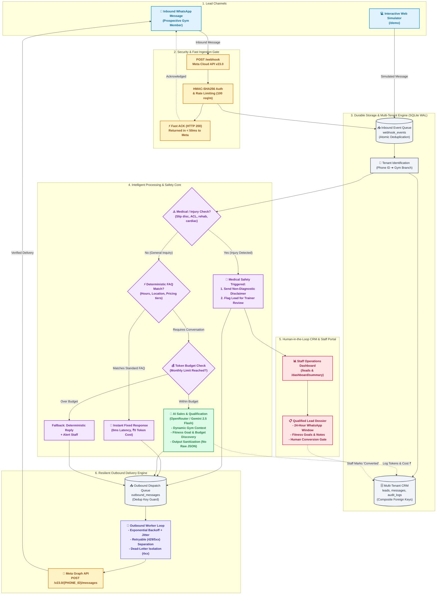

# Goldkraft Fitness — Enterprise WhatsApp AI Lead-Management & Multi-Tenant SaaS Platform

[](https://nodejs.org/)
[](https://developers.facebook.com/docs/whatsapp/cloud-api)
[](https://openrouter.ai/)
[](https://www.sqlite.org/wal.html)
[](https://sentry.io/)

A production-grade, highly resilient backend connecting WhatsApp (via **Meta Cloud API v23.0**) to an **intelligent AI sales & qualification agent** (via OpenRouter). Designed for fitness centers, gym franchises, and health clubs, the platform automates 24/7 lead capture, qualifies member intent, eliminates liability risks, and synchronizes conversations into a durable multi-tenant CRM with zero message loss.

---

## Interactive Demo Simulator

The platform includes a built-in, mobile-first **WhatsApp Web Demo & Simulator** (`/demo`) that lets clients, gym owners, and sales teams test the AI agent live in their browser without setting up Meta webhooks or business credentials:

```bash
# Start the server locally and visit in your browser:
npm run dev
# Browser URL: http://localhost:3000/demo (or visit root http://localhost:3000)
```

* **Live AI Chat & Deterministic FAQ responses**
* **One-Click Auto-Play Script** simulating a complete prospect qualification journey
* **Real-time Lead Card Inspector** (captures name, fitness goal, preferred timings, and CRM status)
* **Light / Dark Mode** theme toggle

---

## How the System Works (Client & Technical Flow)

The following diagram illustrates the complete customer journey—from the moment a prospective gym member sends a WhatsApp message, through security verification, safety triage, AI conversation, and CRM lead capture.



---

## Major Features for Clients & Gym Operators

| Major Feature | Client Value & Business ROI | Engineering Implementation |
|---|---|---|
| **24/7 Instant WhatsApp Concierge** | Never lose midnight or weekend prospects. Inbound messages are answered in seconds with a warm, encouraging fitness tone. | Meta Cloud API v23.0 webhook handler, sub-50ms fast acknowledgment, and asynchronous worker loop. |
| **Zero-Cost Deterministic Router** | Saves **60%–80% in AI API costs**. Common queries (operating hours, location, parking, pricing plans) are answered instantly for ₹0. | Regex/keyword rule matcher running before the LLM, answering queries with 0 tokens and 0 latency. |
| **Medical Safety & Liability Shield** | Protects the gym from medical liability. If a prospect mentions injuries (slipped disc, ACL tear, heart conditions), the bot never gives medical advice. | Automated injury classifier that triggers a legally protective non-diagnostic disclaimer and flags human trainers. |
| **Multi-Tenant Franchise Isolation** | Run dozens of gym locations or separate brands on a single platform. Branch data, phone IDs, and configurations are 100% isolated. | Phone Number ID auto-resolution to `tenant_id`, composite database keys `(tenant_id, wa_id)`, and strict DAL boundaries. |
| **Human-in-the-Loop Conversion Gate** | Prevents AI hallucination from distorting revenue. The AI qualifies leads, but only authorized human staff can mark a lead as `converted`. | Invariant 5 policy enforcement; `/leads/:wa_id` PATCH endpoint restricted to staff with immutable audit logging. |
| **AI Cost & Token Budget Guardrails** | Eliminates surprise API bills. Gym owners can set monthly token and rupee caps per franchise branch. | Real-time `ai_usage` logging (input/output tokens, latency, cost in ₹ INR) with graceful fallback when limits are reached. |
| **Bulletproof At-Least-Once Delivery** | Zero dropped customer messages. Handles network drops, Meta rate limits, or server restarts gracefully. | SQLite WAL mode, persistent inbound/outbound queues, exponential backoff with jitter, and dead-lettering. |
| **Zero-Downtime Atomic Backups** | Continuous business protection. Live database backups without locking active readers or writers. | Automated `VACUUM INTO` command with immediate `PRAGMA integrity_check` and 14-cycle retention pruning. |

---

## Client Lead Lifecycle: From Inquiry to Member

```
1. Inbound Text ➔ Prospect messages WhatsApp: "Hi, I'm looking for personal training in Bangalore."
2. Triage & Auth ➔ Webhook verifies cryptographic HMAC-SHA256 signature and returns 200 OK instantly.
3. Queue Ingestion ➔ Message is safely stored in SQLite with atomic deduplication.
4. AI Qualification ➔ OpenRouter Gemini agent asks about fitness goals, experience, and preferred slots.
5. Safety Check ➔ Checks if injuries are present; applies disclaimer and flags staff if necessary.
6. CRM Capture ➔ Dossier updated: Name, Phone, Goal: Weight Loss, Stage: Qualified, Needs Human: False.
7. Staff Handoff ➔ Gym manager views Dossier on /leads dashboard, schedules free trial, and sets status to Converted.
```

---

## Database Architecture & Schema Migrations

The database engine utilizes **SQLite in WAL (Write-Ahead Logging) mode**, ensuring high-concurrency reading and writing without database locks. Schema changes are managed via an ordered, tracked migration runner (`src/db/migrations.js`):

| Migration | Name | Tables / Capabilities Added |
|---|---|---|
| **001** | `001_initial_schema` | Baseline `leads` and `messages` tables with indexing |
| **002** | `002_multi_tenancy` | `tenants` table, `tenant_id` scoping, and default `goldkraft` seed |
| **003** | `003_durable_queues` | `webhook_events` and `outbound_messages` resilient queue tables |
| **004** | `004_ai_handoffs_and_auth` | `ai_usage` (token/cost tracking), `handoffs`, `audit_logs`, `users` |
| **005** | `005_composite_tenant_leads_and_fk_safety` | Upgrades `leads` to composite `(tenant_id, wa_id)` primary key with foreign key cascading |

To execute migrations:
```bash
npm run migrate
```
*(Migrations also run automatically on service startup with foreign-key integrity validation).*

---

## Complete API Reference

### Public & Lead Endpoints

| Method | Path | Description | Access |
|---|---|---|---|
| `GET` | `/` | Service status, gym facility details, operating hours, and location | Public (redirects browsers to `/demo`) |
| `GET` | `/demo` | Mobile-first interactive WhatsApp demo & conversation simulator | Public |
| `POST` | `/demo/chat` | Send a simulated message through the full AI & qualification pipeline | Rate-Limited / Public |
| `GET` | `/demo/conversation` | Retrieve conversation history for the demo session | Rate-Limited / Public |
| `GET` | `/demo/lead` | Retrieve the active demo lead card and qualification status | Rate-Limited / Public |
| `POST` | `/demo/reset` | Reset demo conversation and lead state back to initial state | Rate-Limited / Public |
| `GET` | `/health` | Liveness health probe (uptime, timestamp) | Public |
| `GET` | `/health/ready` | Readiness health probe (validates live SQLite connection) | Public |
| `GET` | `/webhook` | Meta Webhook verification handshake (`hub.challenge`) | Public / Meta |
| `POST` | `/webhook` | Meta Webhook event ingestion (requires `X-Hub-Signature-256`) | HMAC-SHA256 Verified |

### Protected CRM & Staff Dashboard Endpoints
*Requires header: `Authorization: Bearer <DASHBOARD_API_KEY>` or `x-api-key: <DASHBOARD_API_KEY>`*

| Method | Path | Description | Key Query / Body Parameters |
|---|---|---|---|
| `GET` | `/leads` | List and search qualified leads | `status`, `needs_human`, `sort` (`recency`, `needs_human_first`), `limit`, `offset` |
| `GET` | `/leads/:wa_id` | View full lead dossier, 24-hr service window, and conversation history | `wa_id` (Customer WhatsApp ID) |
| `PATCH` | `/leads/:wa_id` | Update lead status, notes, or assign human agent | `status`, `notes`, `needs_human`, `interest`, `display_name` |
| `GET` | `/dashboard/summary` | Aggregated metrics: leads by stage, active handoffs, AI token/cost usage, queue health | None |

---

## Environment Configuration

Create a `.env` file from the provided `.env.example`:

| Environment Variable | Required in Prod | Description | Default |
|---|---|---|---|
| `PORT` | No | HTTP server port | `3000` |
| `NODE_ENV` | No | Application environment (`development`, `production`, `test`) | `development` |
| `LOG_LEVEL` | No | Logging verbosity (`debug`, `info`, `warn`, `error`) | `info` (prod) / `debug` (dev) |
| `DASHBOARD_API_KEY` | **Yes** | Master security key for protected CRM & dashboard endpoints | — |
| `META_ACCESS_TOKEN` | **Yes** | System User Permanent Token from Meta Business Settings | — |
| `META_PHONE_NUMBER_ID` | **Yes** | WhatsApp Business Account Phone Number ID | — |
| `META_WEBHOOK_VERIFY_TOKEN`| **Yes** | Secret handshake string configured in Meta App Webhook settings | — |
| `META_APP_SECRET` | **Yes** | Meta App Secret for validating incoming SHA256 signatures | — |
| `OPENROUTER_API_KEY` | **Yes** | OpenRouter API Key for LLM inferences | — |
| `OPENROUTER_MODEL` | No | Primary conversational qualification model | `google/gemini-2.5-flash` |
| `OPENROUTER_FALLBACK_MODEL`| No | Secondary backup model if primary experiences outage | `google/gemini-2.5-flash-lite` |
| `DATABASE_PATH` | No | Path to SQLite database file | `./data/goldkraft_leads.db` |
| `SENTRY_DSN` | No | Sentry DSN for exception tracking and crash telemetry | — |

---

## Operations & Disaster Recovery

### Running Locally
```bash
npm install
cp .env.example .env
# Fill in your Meta and OpenRouter API credentials
npm run dev
```

### Running Automated Test Suite
```bash
# In PowerShell:
$env:NODE_ENV="test"; node --test test/**/*.test.js

# Or via npm on Linux/macOS:
npm test
```

### Atomic Database Backups
SQLite WAL mode allows non-blocking atomic backups during active writing:
```bash
npm run backup
```
**Mechanism:**
1. Executes `VACUUM INTO '<timestamped-backup>.db'` creating a point-in-time snapshot.
2. Runs `PRAGMA integrity_check;` on the backup to ensure zero database corruption.
3. Automatically prunes older backups, retaining the 14 most recent snapshots.

### Emergency Database Restore
```bash
# 1. Stop the application service
systemctl stop gkf-wa

# 2. Verify backup integrity
node -e "const { DatabaseSync } = require('node:sqlite'); const db = new DatabaseSync('data/backups/<backup-file>.db'); console.log(db.prepare('PRAGMA integrity_check;').get());"

# 3. Replace live database with verified backup
cp data/backups/<backup-file>.db data/goldkraft_leads.db
rm -f data/goldkraft_leads.db-wal data/goldkraft_leads.db-shm

# 4. Restart application service
systemctl start gkf-wa
```

### Queue Dead-Letter Recovery
If Meta or OpenRouter experiences an extended outage, jobs enter the `dead_letter` state. Once upstream service restores, replay jobs with zero data loss:
```sql
-- View dead-lettered events:
SELECT id, event_key, last_error, attempts, updated_at FROM webhook_events WHERE status = 'dead_letter';

-- Re-enqueue inbound events:
UPDATE webhook_events SET status = 'pending', attempts = 0, available_at = datetime('now') WHERE status = 'dead_letter';

-- Re-enqueue outbound messages:
UPDATE outbound_messages SET status = 'pending', attempts = 0, available_at = datetime('now') WHERE status = 'dead_letter';
```

---

## Architectural Guarantees & Boundaries

1. **Delivery Guarantee:** Resilient **at-least-once** external delivery. Outbound message deduplication is enforced by `dedup_key` in `outbound_messages`.
2. **AI Conversion Safeguard:** AI cannot self-certify leads as converted. Conversions require staff confirmation via authenticated API.
3. **Medical Safety Non-Negotiable:** Under no circumstance does the AI prescribe medical, injury, or physical therapy regimens.
4. **Data Isolation:** Franchise data boundaries are enforced at the database schema level with composite tenant foreign keys.
5. **Observability & PII Redaction:** Phone numbers are masked in production logs (`91*****3210`) to comply with privacy regulations.
