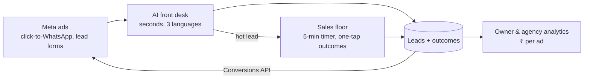

# Lead Engine

**Connects digital marketing and sales with AI, on WhatsApp.** Ads bring leads; an AI front desk answers in seconds and qualifies them; the sales team is pushed to follow up fast and log outcomes; owners and agencies see which ads produced paying customers; and those outcomes flow back to Meta so the ads improve.

Built for local businesses in India (gyms first), sold through marketing agencies. *Lead Engine* is a working name.

**Status:** live pilot with Goldkraft Fitness, Bengaluru, since 29 Oct 2026. Bot at `wa.goldkraftfitness.com`, staff CRM at `crm.goldkraftfitness.com`.



## What works today

- **WhatsApp bot:** Meta Cloud API webhook with signed requests and durable Postgres queues. AI replies (DeepSeek V4.1 Flash, Gemini fallback) in one call, about ₹26 per 1,000 replies. Free fixed answers in English, Hinglish and Kannada, with tap buttons and a map pin. Medical safety, staff hand-off with Telegram alerts, click-to-WhatsApp ad attribution, a bot pause while staff handle a lead, and per-lead and monthly AI caps.
- **Staff CRM:** owner/manager/sales roles, lead list and pipeline, chat with WhatsApp replies (24h-window aware), notes, follow-ups, assignment, reports (including per-ad leads and AI cost), CSV export.
- **Ops:** one Heroku dyno + Postgres (~$12/month), daily backups, Sentry, CI on every PR.

## What's next

Sales floor → owner analytics → Meta loop (Lead Ads, Conversions API) → multi-client platform with self-serve onboarding. See the [roadmap](docs/PRODUCT_PLAN.md#4-roadmap).

## Docs

| Doc | Read it for |
| --- | --- |
| [docs/ARCHITECTURE.md](docs/ARCHITECTURE.md) | How it works, with diagrams: message flow, reply logic, data model, code map, target multi-client design |
| [docs/PRODUCT_PLAN.md](docs/PRODUCT_PLAN.md) | Market, features, roadmap, cost plan, pricing, risks, metrics |
| [docs/META_PLATFORM.md](docs/META_PLATFORM.md) | Meta facts that constrain us: onboarding, pricing, limits, AI policy, BSUID, APIs we'll use |
| [docs/META_APP_REVIEW.md](docs/META_APP_REVIEW.md) | Becoming a Meta Tech Provider: App Review settings, videos, permission texts |
| [docs/ONBOARDING.md](docs/ONBOARDING.md) | How a client goes live (target self-serve flow + today's manual steps) |
| [docs/OPERATIONS.md](docs/OPERATIONS.md) | Local dev, config vars, tests, deploy, backups, incident runbook |
| [docs/TEAM.md](docs/TEAM.md) | For collaborators: the idea, who owns what, task list, how we work |
| [crm/README.md](crm/README.md) | CRM internals: roles, tables, pages |
| [CLAUDE.md](CLAUDE.md) | Rules and commands for Claude Code in this repo |

## Quick start

```bash
npm ci
```

```bash
cp .env.example .env
```

```bash
npm run dev
```

Bot on http://localhost:3000 and CRM on http://crm.localhost:3000, using in-process Postgres (PGlite). No keys are needed: without them, AI replies, WhatsApp sends and alerts are simulated. Log in with an account from [`crm/seed/users.example.json`](crm/seed/users.example.json).

```bash
npm test
```

Runs every bot and CRM test on an in-memory database; it never calls Meta, OpenRouter or Telegram.

## Repo layout

```
src/        bot: webhook, queues, reply logic, AI, Meta client, database
crm/        staff CRM (Express + EJS), mounted on the CRM hostname
scripts/    migrations, backup/restore, demo data, model evaluation
test/       tests (test/crm for the CRM)
docs/       product and engineering docs
```

Stack: Node 24, Express 4, EJS, Postgres (Heroku Postgres / PGlite), Meta WhatsApp Cloud API, OpenRouter.
