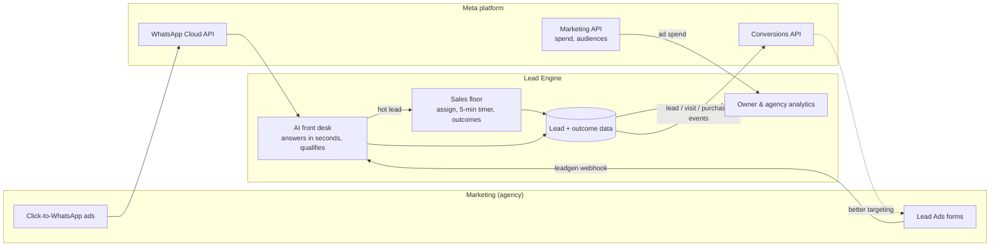
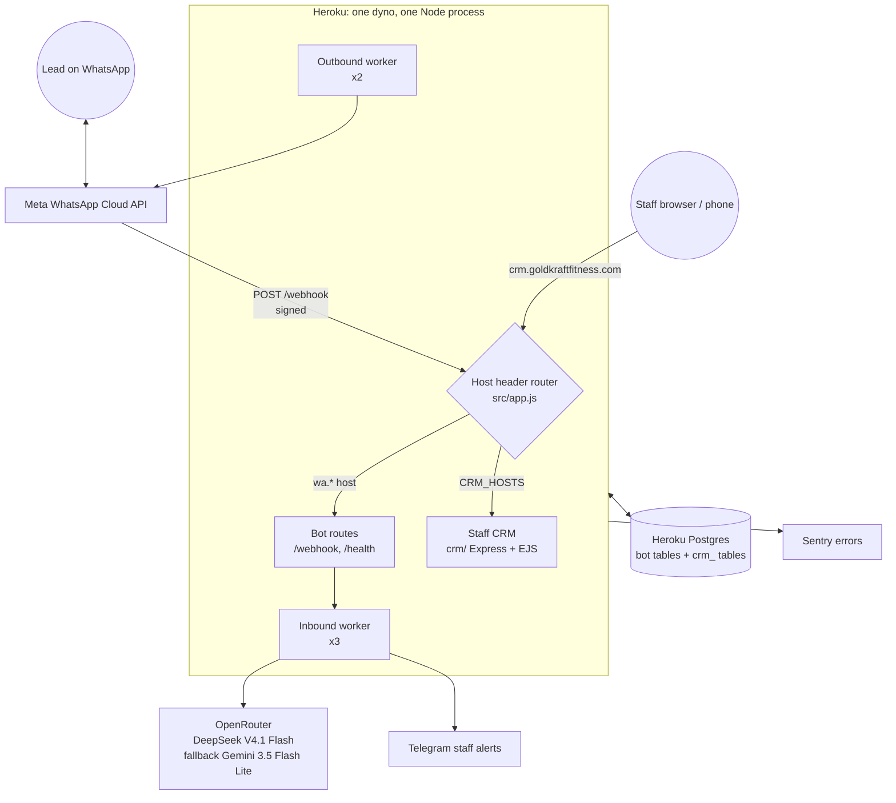
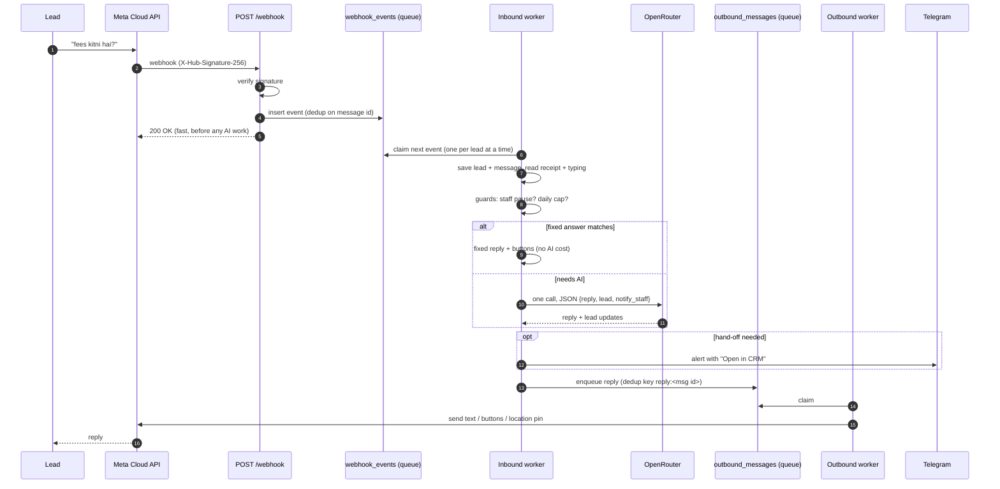
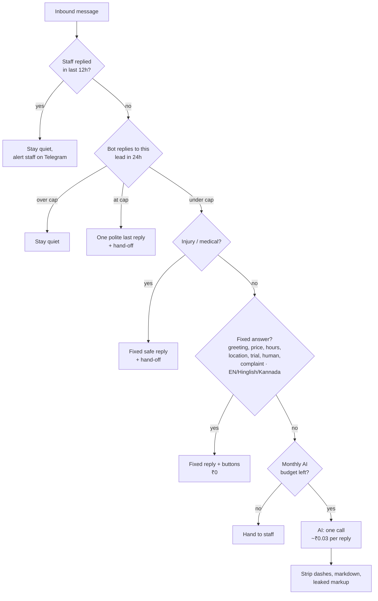
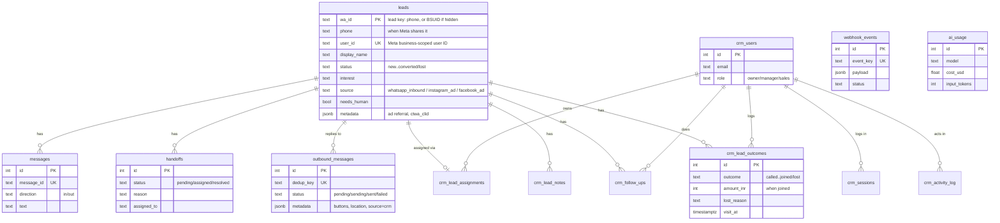
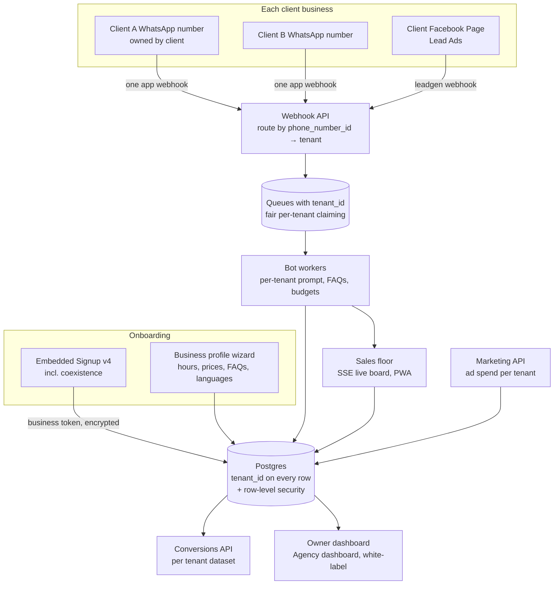

# Architecture

How the system works today, and the architecture we are moving to. **Lead Engine** is a working name for the product. The first client, Goldkraft Fitness (GKF), is the live pilot.

- [1. The idea in one picture](#1-the-idea-in-one-picture)
- [2. What runs today](#2-what-runs-today)
- [3. Life of a WhatsApp message](#3-life-of-a-whatsapp-message)
- [4. How the bot decides a reply](#4-how-the-bot-decides-a-reply)
- [5. Data model](#5-data-model)
- [6. Code map](#6-code-map)
- [7. Design rules we keep](#7-design-rules-we-keep)
- [8. Target architecture (multi-client)](#8-target-architecture-multi-client)
- [9. Known gaps](#9-known-gaps)

---

## 1. The idea in one picture

Marketing agencies run Meta ads for local businesses (gyms first). Leads come in on WhatsApp or through lead forms. An AI answers in seconds and qualifies them. Hot leads go to a salesperson with a timer. Every outcome (contacted, visited, joined + ₹) is recorded and sent back to Meta so the ads learn who actually buys.



## 2. What runs today

One Node.js process serves both the WhatsApp bot and the staff CRM, chosen by the request's hostname. One Postgres database holds everything. It runs on Heroku: one Basic dyno + Postgres Essential-0, about $12/month.



| Piece | Where | Notes |
| --- | --- | --- |
| Webhook + queues | `src/controllers`, `src/workers`, `src/db` | Postgres-backed queues, `FOR UPDATE SKIP LOCKED`, retries with backoff, dead letters |
| Reply logic | `src/services` | Safety check → fixed answers → AI, plus guards (pause, caps, budget) |
| Staff CRM | `crm/` | Roles owner/manager/sales, chat, pipeline, notes, follow-ups, reports, CSV |
| Business facts + AI prompt | `src/config/gymConfig.js` | **GKF-specific today**; moves to the database for multi-client |
| Migrations | `src/db/schema.js`, `crm/src/migrations.js` | Run in Heroku's release phase and on boot, under advisory locks |
| Backups | Heroku PG daily schedule + `scripts/backup.js` to Telegram | |

## 3. Life of a WhatsApp message



Why two queues: Meta needs a quick `200` or it retries, and AI calls take 1-3 seconds. Saving first and answering later means no lost messages on crashes, deploys or AI outages. Both queues are plain Postgres tables, so there's no extra service to pay for.

## 4. How the bot decides a reply



Cost levers, in order of impact: fixed answers (free), one AI call per reply instead of two, a stable prompt prefix that the provider caches (DeepSeek bills cached input at 0.1×), short history (10 messages), and hard caps per lead and per month.

## 5. Data model

Bot tables are owned by `src/db/schema.js`; CRM tables (prefixed `crm_`) by `crm/src/migrations.js`. A lead's key is `wa_id`: its phone number, or Meta's business-scoped user ID (BSUID) when the user hides their phone behind a WhatsApp username. `phone`, `user_id` and `username` hold whatever Meta has shared.



## 6. Code map

```
src/
  app.js                 Express app; Host router (bot vs CRM), https redirect
  server.js              boot: migrations, workers, graceful shutdown
  config/env.js          every setting, from environment variables
  config/gymConfig.js    GKF facts + AI system prompt (per-client data later)
  controllers/           webhook verify + receive
  middleware/            signature check, rate limit
  workers/               queueWorker base, inbound (webhookWorker), outbound
  services/
    deterministicRouter  fixed answers, language detection, buttons
    aiService            prompt building, OpenRouter call, JSON parsing, cleanup
    aiPolicy             what the AI may change; medical safety check
    botGuard             staff pause + per-lead daily cap
    leadUpdates          applies updates, opens hand-offs
    adAttribution        click-to-WhatsApp referral → lead source
    notifyService        Telegram alerts
    whatsappService      Cloud API sends (text, buttons, location), read receipts
    aiCostTracker        usage + monthly budget
  db/                    pg/PGlite driver, schema, repositories
crm/                     staff CRM (Express + EJS), mounted by src/app.js
scripts/                 migrate, backup/restore, demo data, model eval
test/                    node:test on in-memory PGlite; test/crm for the CRM
docs/                    you are here
```

## 7. Design rules we keep

1. **Answer Meta fast, work later.** The webhook only verifies and stores. All real work happens in queue workers.
2. **Every side effect is idempotent.** Dedup keys on inbound events and outbound replies, so retries and redeploys never double-send.
3. **Postgres is the only infrastructure.** Queues, sessions, locks and data all live in one database until scale proves otherwise.
4. **Free before paid.** Fixed answers and buttons first, AI second, staff third. One AI call per reply. Hard budgets.
5. **The AI proposes, policy decides.** The model can suggest lead updates; `aiPolicy` decides what's allowed (it can't mark a lead converted or clear a hand-off).
6. **Never invent facts.** The prompt only knows the business profile. Anything else gets "a coach will confirm".
7. **Tests never touch real services.** In-memory PGlite and fake transports. Paid model checks are opt-in scripts.

## 8. Target architecture (multi-client)

What changes when we serve many businesses from one deployment. See [PRODUCT_PLAN.md](PRODUCT_PLAN.md) for when.



Key decisions:

- **Tenant = one business.** Every table gets `tenant_id`; Postgres row-level security makes cross-tenant leaks impossible even with a buggy query.
- **Routing by `phone_number_id`.** All clients' WhatsApp numbers point at one webhook; the payload's `metadata.phone_number_id` picks the tenant.
- **Secrets per tenant**, encrypted in the database (business tokens from Embedded Signup), never in environment variables.
- **Business profile in the database** replaces `gymConfig.js`. The prompt and fixed answers are generated from it. Vertical packs (gym, clinic, salon, coaching, real estate) give defaults.
- **Lead identity:** matched by BSUID first, then phone; send to the phone when known, else to the BSUID (done, see [META_PLATFORM.md](META_PLATFORM.md#5-usernames-and-bsuid-identity-change)). With tenants, BSUIDs are per business portfolio, so the lookup is per tenant.
- **Fair queues.** One client's ad spike must not delay others: claim work round-robin across tenants, and keep per-tenant AI budgets and caps.
- **Same stack until ~50 clients.** One app, one Postgres, more dynos. Move hosting to an India region when the first paying non-GKF client signs.

## 9. Known gaps

Ordered by risk; owners and timing are in [PRODUCT_PLAN.md](PRODUCT_PLAN.md) and [TEAM.md](TEAM.md).

| Gap | Why it matters |
| --- | --- |
| Single tenant (GKF facts in code, one number) | Can't onboard client #2 without code changes. |
| No speed-to-lead timer or live board (outcomes are logged since R1) | Hot leads can sit unanswered unnoticed. |
| No templates for leads outside the 24h window | Can't win back no-shows and quiet leads. |
| No Lead Ads webhook / Conversions API | Missing the strongest Meta optimisation loop. |
| One dyno in the EU, student credits | Not suitable for paying clients' data or uptime. |
