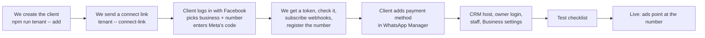

# Client onboarding

How a new business goes live on the shared deployment. Any business that runs Meta ads for leads can be onboarded; the business type only picks a preset.

Since 15 Nov 2026 we are a **Meta Tech Provider** (App Review approved: advanced access to `whatsapp_business_messaging` and `whatsapp_business_management` on app `4690351227913482`). So a client connects their own WhatsApp number to our app from a link (**Embedded Signup**, K9). They keep ownership of their WhatsApp account and Meta bills them directly. No Meta app, token or webhook set-up on their side.



## 1. One-time set-up (us, once per Meta app)

Do this once before the first client. Steps 1 to 3 are in the [Meta app dashboard](https://developers.facebook.com/apps/4690351227913482/); Meta renames menu items now and then, so the labels below may differ slightly.

1. **Facebook Login for Business → Configurations → Create configuration.**
   - Login variation: **WhatsApp Embedded Signup**, the newest version offered (v4 or later; v2 and v3 stopped on 15 Oct 2026).
   - Access token: pick **never expires** if offered. Meta's template is called "…With 60 Expiration Token", so it may default to 60 days. We save any expiry Meta returns: `tenant -- list` shows `token_expires`, and the ops alert names the date. A client with an expiring token must reconnect before it, or replies stop. Confirm which you got on the first live run (step 5).
   - Assets: **WhatsApp accounts**. Permissions: `whatsapp_business_management`, `whatsapp_business_messaging`.
   - Save and copy the **Configuration ID**.
2. **Facebook Login for Business → Settings:** turn on *Client OAuth login*, *Web OAuth login*, *Enforce HTTPS* and *Login with the JavaScript SDK*. In **Allowed domains for the JavaScript SDK** add `https://wa.goldkraftfitness.com` (the bot host; connect pages only work there). Also add `wa.goldkraftfitness.com` under **App settings → Basic → App domains**.
3. **WhatsApp → Configuration → Webhook:** the callback stays `https://wa.goldkraftfitness.com/webhook` (our shared app; messages are routed to the client by phone number id). Subscribe: `messages`, `account_update`, `phone_number_quality_update`, `account_alerts`, `account_review_update`, `business_capability_update`. For WhatsApp Business app numbers also `smb_message_echoes`, `history`, `smb_app_state_sync` (received; see [Limits](#limits-of-whatsapp-business-app-numbers)).
4. **Heroku** (production config, so only when Kaamil says so):
   ```bash
   heroku config:set META_APP_ID=4690351227913482 META_ES_CONFIG_ID=<configuration id> BOT_BASE_URL=https://wa.goldkraftfitness.com -a gkf-wa
   ```
   With either id empty, connect pages say "not switched on yet" and nothing else changes.
5. **First run on a spare number** (a test SIM in a test business): make a test tenant, open its link, connect, then `heroku run -a gkf-wa "npm run tenant -- list"` shows `connected_via: connect link (cloud)` and `token_expires` (should be `never`). Message the number from a phone and check the reply. Until this run passes, the live flow is untested: the tests only use a fake Meta.

## 2. Before the call: ask the client

1. What is the business type, and what do customers buy or book?
2. **Which number?**
   - A **new number** (not on WhatsApp): simplest. Any SIM or landline that can get an SMS or call.
   - A number on the **WhatsApp Business app**: they can keep using the app (coexistence). Read [the limits](#limits-of-whatsapp-business-app-numbers) first.
   - A number on **personal WhatsApp** can't be used until they delete that WhatsApp account.
3. Who has **admin** on their Facebook business (Meta Business portfolio)? That person does the connect step. No portfolio yet: they can create one during the flow.
4. Is the business **verified** with Meta? Until it is, a new number can start only 250 new conversations a day.
5. How many staff use the CRM? Who are the managers?
6. Which languages do customers write in?
7. Their facts: address, hours, prices, policies, FAQs, tone.

## 3. Per client (about an hour)

All commands run on Heroku (they need `DATABASE_URL` and `TENANT_SECRETS_KEY`). Type them in your own terminal, not in a chat: some print one-time passwords.

1. **Create the client.** Copy `clients/tenant.example.json` to `clients/<client>.json` (git-ignored). Fill in `slug`, `name`, `type`, `crmHost`; leave the WhatsApp fields and secrets empty. Then:
   ```bash
   heroku run -a gkf-wa "npm run tenant -- add clients/<client>.json"
   ```
   (Copy the file in with `heroku run bash`, or pass the values another way; see `scripts/tenant.js`.)
2. **Send the connect link.**
   ```bash
   heroku run -a gkf-wa "npm run tenant -- connect-link <slug>"
   ```
   Valid 72 hours (`connect-link <slug> 24` for 24). The link is for **new numbers only**. For a number on the WhatsApp Business app, add `--app-number`, after reading [the limits](#limits-of-whatsapp-business-app-numbers). The link is a secret: anyone with it can connect a number to this client until it is used or expires, so send it privately to the person with Facebook admin (it is hidden from our logs and Sentry). Use a shorter life when you can, e.g. `connect-link <slug> 24`.
3. **The client connects** (5 minutes): opens the link on a computer or phone, picks the kind of number, logs in with Facebook, chooses or creates the business and WhatsApp account, adds the number and enters Meta's code. The page says "Connected: <number>". Behind it:
   - the code from Facebook (valid 30 seconds) is exchanged for the client's own business token;
   - we check that token really controls the WhatsApp account and number the page named, then save it encrypted;
   - our app is subscribed to their WhatsApp account's webhooks;
   - a new number is registered with a random 6-digit PIN (stored encrypted; Meta asks for it if the number is ever moved). A WhatsApp Business app number is not registered again; instead the contacts and history sync starts (Meta requires it within 24 hours).

   The ops Telegram group gets "WhatsApp connected for <client>". If registration fails with a **two-step verification PIN** error, the number was on WhatsApp before and has its own PIN: the client turns off two-step verification for it in WhatsApp Manager (Phone numbers → Settings), then you run `whatsapp-finish`.
   If it says a step failed, run `heroku run -a gkf-wa "npm run tenant -- whatsapp-finish <slug>"`; it retries only the failed steps and prints Meta's error. Cancels and errors in the Facebook popup are logged as `Embedded Signup session event` (`heroku logs -a gkf-wa | grep "session event"`).
4. **Payment method (client).** Meta Business Suite → WhatsApp Manager → **Payment methods**. Meta bills them directly for messages at Meta's rates for their country. Without a payment method, paid messages fail once any free allowance is used.
5. **Display name.** WhatsApp Manager → Phone numbers: the display name must be approved. Meta checks it against the business; a mismatch delays it.
6. **Staff alert template** on their WhatsApp account (needs their WABA id and token; run where `TENANT_SECRETS_KEY` is set):
   `META_WABA_ID=… META_ACCESS_TOKEN=… BUSINESS_NAME="…" CRM_BASE_URL=https://crm.<client>.com node scripts/create-template.js staff_lead_alert`, then wait for "APPROVED" (`--status`).
7. **CRM address.** `heroku domains:add crm.<client>.com -a gkf-wa`; the client points DNS at the target it prints.
8. **Owner login.** `heroku run -a gkf-wa "npm run crm:owner -- --tenant <slug> 'Owner Name' owner@client.com '+91XXXXXXXXXX'"` (phone optional; they can then sign in with phone or email). Give the one-time password in person. Never run `crm:seed` for a client: its passwords are in the repo.
9. **Team.** The owner adds staff on **Staff** (one by one with a sign-in phone, or **Add many**). Optional: a Telegram group for their alerts (`settings.telegramChatId`).
10. **Business settings.** The owner fills in the facts and business type and reads the prompt preview. Until then the assistant uses neutral placeholders, never another client's facts.
11. **Zoho**, if they use it: see [Zoho CRM](#zoho-crm-k20).
12. **Test checklist** (below) from a phone that never chatted with the number. Then the agency points ads at the number.

Manage clients with `npm run tenant -- list | set <slug> <file> | suspend <slug> | activate <slug>`. Each has its own AI budget, reply cap and pause hours (`settings`). Costs: no extra dyno or database; only the client's own AI use.

### Limits of WhatsApp Business app numbers

Meta's rules for coexistence, plus what we don't handle yet:

- The app must be version 2.24.17 or newer. Linked devices are logged out during onboarding; WhatsApp for Windows and WearOS aren't supported.
- Throughput is fixed at 20 messages a second. Group chats, broadcast lists, disappearing and view-once messages don't sync.
- **Not built yet:** replies staff send from the phone app (`smb_message_echoes`) and the synced history and contacts reach our webhook but are dropped, not stored or shown in the CRM. The assistant doesn't see those replies either, so it can answer a chat a person is already handling in the app. That's why connect links allow these numbers only with `--app-number`. Until this is built, prefer a new number, or ask staff to reply from the CRM.
- Meta requires the history sync to start within 24 hours of connecting, or the client has to disconnect and connect again; we start it straight away (`whatsapp-finish` retries it).

### If Embedded Signup can't be used

Fallback for a client who can't do the Facebook step (for example their admin won't log in): their **own Meta app**. In their Meta Business: create an app (type Business), add WhatsApp, link their WhatsApp account and number. Create a system user, give it the WhatsApp account (full control) and generate a never-expiring token with all three of `whatsapp_business_messaging`, `whatsapp_business_management`, `catalog_management` (fewer scopes on the same system user breaks its other tokens; see [META_PLATFORM.md §6](META_PLATFORM.md#6-tokens-and-permissions-learned-the-hard-way)). Put the phone number id, WABA id, token and app secret in `clients/<client>.json` and run `tenant -- add`; it prints a `/webhook/<slug>` URL and verify token for their app's webhook. They send secrets through a password manager, never chat or email.

## Zoho CRM (K20)

If the client uses Zoho (see [TEAM.md](TEAM.md#zoho-crm-sync-k20-built)), with their Zoho admin on a call:

1. Optional but best: in Zoho, add a single-line custom field **Lead Engine ID** (API name `Lead_Engine_ID`, unique) on Leads, Contacts and Deals, and map it in **Lead conversion mapping**. Then nothing is duplicated and deals they convert themselves still match. Without it we match by mobile number.
2. Open the Zoho API console for their data centre (`api-console.zoho.in`, `.com`, `.ae`, `.sa`...) → **Self Client** → **Generate Code** with scope `ZohoCRM.modules.leads.ALL,ZohoCRM.modules.contacts.ALL,ZohoCRM.modules.accounts.ALL,ZohoCRM.modules.deals.ALL,ZohoCRM.org.READ`, 10 minutes. Copy the client ID, client secret and code.
3. Within those 10 minutes, where `DATABASE_URL` and `TENANT_SECRETS_KEY` are set: `ZOHO_CLIENT_ID=… ZOHO_CLIENT_SECRET=… ZOHO_CODE=… npm run zoho -- --tenant <slug> connect --accounts https://accounts.zoho.in --id-field Lead_Engine_ID` (add `--pipeline "<name>"` if their Deals use pipelines, `--won-stage`/`--lost-stage` if their stage names differ from Closed Won / Closed Lost). It prints the Zoho organisation name and currency when it works.
4. `npm run zoho -- --tenant <slug> backfill --days 30` sends recent leads; `status` shows progress and errors.

## Website form and portals (R16)

If the client gets leads from their website or property portals:

1. On **Business settings → Lead sources** (as the owner): add their website address(es), set the country code for local numbers (91 India, 971 UAE), and **Make a form key**. Send the **Website form** code to whoever runs their website; it needs a phone number, and it asks for WhatsApp consent.
2. For a portal or Zapier: **Make a signing secret** (shown once) and give the portal the address and secret. They send signed JSON (`docs/TEAM.md`, R16).
3. WhatsApp welcome message: create `lead_welcome` on the client's WhatsApp account, and once Meta approves it set `leadWelcomeTemplate` for the client (and `leadWelcomeLanguage`, e.g. `ar`, if the template isn't English) (`npm run tenant -- set <slug> <file.json>` with `{ "settings": { "leadWelcomeTemplate": "lead_welcome" } }`). Until then, form leads get a hand-off but no WhatsApp message.
4. Test with the client: submit the form once, check the lead, the hand-off and **Last 20 submissions**.

## Test checklist

From a phone that has never chatted with the number, send each and check the reply and the CRM:

| # | Message | Expect |
| --- | --- | --- |
| 1 | "Hi" | Greeting with the business name, one qualifying question |
| 2 | Price question | Prices from Business settings only |
| 3 | Trial, visit or demo request | Booking flow or hand-off; staff alert arrives |
| 4 | Same in Hinglish, then their regional language | Reply in that language |
| 5 | Ask for a discount | No invented offers |
| 6 | "Call me" | Hand-off; lead shows in the CRM with the reason |
| 7 | A fact not in Business settings | "I'll check with the team", no made-up answer |
| 8 | A sensitive or off-topic question | Stays on the business |
| 9 | "ok thanks" | Short close, no new question |
| 10 | An image | Handled without error |
| 11 | "STOP", then "hi" | A fixed "we won't message you" reply; then a normal reply (writing again opts them back in) |

## What comes next

- **R8 onboarding wizard** (Krishna, with K9): an owner-only "Connect WhatsApp" button in the CRM that opens the same connect page (`embeddedSignup.linkUrl(tenantId)`), then profile, brand, team and test chat in one flow.
- Coexistence echoes and history in the CRM (see the limits above).
- `catalog_management` and `whatsapp_business_manage_events` for other clients' numbers need their own App Review (K24 catalog, K7b Conversions API).
