# Client onboarding

How a new business goes live: the target self-serve flow (Phase D) and the manual flow we use until then.

## Target flow (under an hour)

```mermaid
flowchart LR
  S1[Agency creates client<br/>picks vertical pack] --> S2[Client connects WhatsApp<br/>Embedded Signup v4<br/>new number or coexistence]
  S2 --> S3[Business profile wizard<br/>hours, prices, location,<br/>FAQs, languages, tone]
  S3 --> S4[Preview chat<br/>see how the bot answers]
  S4 --> S5[Team: owner, managers,<br/>sales + shifts]
  S5 --> S6[Connect Page + ad account<br/>Lead Ads, spend, Conversions API]
  S6 --> S7[Test checklist<br/>10 scripted messages pass]
  S7 --> S8[Go live<br/>agency launches ads]
  S8 --> S9[Week-1 review<br/>auto report]
```

| Step | Who | What happens in the system |
| --- | --- | --- |
| 1. Create client | Agency | New tenant with defaults from the vertical pack |
| 2. Connect WhatsApp | Client (Facebook login) | Embedded Signup v4 returns a code → we exchange it for a business token (encrypted per tenant), register the number (within 14 days), subscribe the app to the WABA webhooks. Coexistence: number shows "syncing" up to 24h |
| 3. Business profile | Client or agency | Stored in the database; generates the AI prompt and fixed answers |
| 4. Preview | Client | Runs the real prompt in a sandbox chat (counts against our AI budget, capped) |
| 5. Team | Owner | Invites by email; first login forces a password change |
| 6. Ads | Agency | Page subscribed to `leadgen`; ad account read access for spend; dataset for Conversions API |
| 7. Test | Us / agency | Price, trial, Hinglish, regional language, injury, discount, "call me", unknown facility, "ok thanks", image |
| 8. Live | Agency | Click-to-WhatsApp and/or Lead Ads campaigns pointed at the number |
| 9. Review | Us + owner | Speed to lead, funnel, best ad, bot hand-off reasons |

## Manual flow (today, until Embedded Signup)

This is how GKF was set up. It takes a few hours and needs access to the client's Meta Business.

1. In the client's Meta Business: create or verify the business, add a WhatsApp Business Account and phone number, verify by OTP.
2. In our Meta app: add the WhatsApp product, link the WABA, subscribe the webhook (`messages`) to `https://<bot host>/webhook` with our verify token.
3. Business Settings → System users → generate a never-expiring token with **all** of `whatsapp_business_messaging`, `whatsapp_business_management`, `catalog_management`. Assign the WABA (full control) and catalog to the system user. Never generate a token with fewer scopes for the same system user (see [META_PLATFORM.md §6](META_PLATFORM.md#6-tokens-and-permissions-learned-the-hard-way)).
4. Set `META_ACCESS_TOKEN`, `META_PHONE_NUMBER_ID`, `META_APP_SECRET`, `META_WEBHOOK_VERIFY_TOKEN` on the server.
5. Edit the business facts and prompt (today `src/config/gymConfig.js`), map pin (`GYM_LATITUDE`/`GYM_LONGITUDE`), deploy.
6. Seed CRM staff (`npm run crm:seed`), Telegram group for alerts (`TELEGRAM_CHAT_ID`).
7. Ice breakers (Conversational Automation API) and catalog, if used.
8. Run the test checklist above from a phone that has never chatted with the number.

Today this setup serves one business per deployment. Multi-client support is Phase D in [PRODUCT_PLAN.md](PRODUCT_PLAN.md).
