# Client onboarding

How a new business goes live: the target self-serve flow (the Platform stage in [PRODUCT_PLAN.md](PRODUCT_PLAN.md#6-order-of-work)) and the manual flow we use until then. Any business that runs Meta ads for leads can be onboarded; the business type only picks a preset.

## Fast-track the next client (now)

Each new client is a **tenant** on the shared deployment (K8). Their data is kept apart by the database itself (row-level security), so no new Heroku app or database is needed. A client that needs its own database (data residency, very high volume) can still get a dedicated deployment with `npm run new-client`.

**Ask the client first:**

1. What is the business type, and what do customers buy or book?
2. Which WhatsApp number? A new number is fastest. A number in the WhatsApp Business app needs coexistence.
3. Who owns the Meta Business Manager and the ad account? Is the business verified?
4. How many staff use the CRM? Who are the managers?
5. Which languages do customers write in?
6. Their facts: address, hours, prices, policies, FAQs, tone.

**Get WhatsApp access (K18).** Our Meta app has not passed App Review yet, so Embedded Signup (K9) is not available. Use one of these paths, in this order:

| Path | How | When |
| --- | --- | --- |
| A. Client's own Meta app (recommended now) | In the client's Meta Business: create a Meta app (type Business), add the WhatsApp product, link their WABA and number. Create a system user, give it the WABA (full control) and generate a never-expiring token with all three scopes (`whatsapp_business_messaging`, `whatsapp_business_management`, `catalog_management`). Set the webhook to our `/webhook/<slug>` URL (printed by `npm run tenant -- add`) with the verify token it prints. They send us the token, app secret and IDs through a password manager, never chat or email | Works today. No App Review needed, because the app and the WABA belong to the same business |
| B. Partner access to their WABA | Client: Business settings → Accounts → WhatsApp accounts → Assign partner → our business ID. We use our own app and system user | Test once on a test business first. Before App Review, our app may not get access to assets of other businesses |
| C. Embedded Signup | Client clicks "Connect WhatsApp" and logs in to Facebook | After App Review approval (K9) |

Check early: business verification (a new number can message only 250 people a day until the business is verified), the display name approval, and the message quality rating. A large client often already has a verified business and a higher tier.

**Then, per client:**

1. Copy `clients/tenant.example.json` to `clients/<client>.json` and fill it in (git-ignored): slug, name, business type, WhatsApp phone number id, WABA id, CRM host, and the secrets (token, app secret). Run `heroku run npm run tenant -- add clients/<client>.json -a gkf-wa`. Secrets are encrypted with `TENANT_SECRETS_KEY` (set once on the app). It prints the webhook URL, the verify token and the next steps.
2. Connect WhatsApp by path A, B or C above.
3. CRM domain: `heroku domains:add crm.<client>.com -a gkf-wa`, then the client points DNS at the target it prints.
4. Create the owner login: `heroku run npm run crm:owner -- --tenant <slug> "Owner Name" owner@client.com -a gkf-wa`. Never run `crm:seed` for a client: its passwords are in the repo. Add staff on **Staff → Add many** (R13): paste their list, then share each one-time password privately. Optional: a Telegram group for their alerts (`settings.telegramChatId`).
5. The owner fills **Business settings** with the facts and business type, and reads the prompt preview. Until then the assistant uses neutral placeholders, never another client's facts.
6. Run the test checklist from a fresh phone. Then the client goes live.

Manage tenants with `npm run tenant -- list | set <slug> <file> | suspend <slug> | activate <slug>`. Each tenant has its own AI budget, reply cap and pause hours (`settings`); defaults come from the env vars. Costs: no extra dyno or database; only the client's own AI use.

## Target flow (under an hour)

```mermaid
flowchart LR
  S1[Agency creates client<br/>picks business-type preset] --> S2[Client connects WhatsApp<br/>Embedded Signup v4<br/>new number or coexistence]
  S2 --> S3[Business profile wizard<br/>hours, prices, location,<br/>FAQs, languages, tone]
  S3 --> S4[Preview chat<br/>see how the bot answers]
  S4 --> S5[Team: owner, managers,<br/>sales + shifts]
  S5 --> S6[Connect Page + ad account<br/>Lead Ads, spend, Conversions API,<br/>dataset restriction check]
  S6 --> S7[Test checklist<br/>10 scripted messages pass]
  S7 --> S8[Go live<br/>agency launches ads]
  S8 --> S9[Week-1 review<br/>auto report]
```

| Step | Who | What happens in the system |
| --- | --- | --- |
| 1. Create client | Agency | New tenant with defaults from the business-type preset |
| 2. Connect WhatsApp | Client (Facebook login) | Embedded Signup v4 returns a code → we exchange it for a business token (encrypted per tenant), register the number (within 14 days), subscribe the app to the WABA webhooks. Coexistence: number shows "syncing" up to 24h |
| 3. Business profile | Client or agency | Stored in the database; generates the AI prompt and fixed answers |
| 4. Preview | Client | Runs the real prompt in a sandbox chat (counts against our AI budget, capped) |
| 5. Team | Owner | Invites by email; first login forces a password change |
| 6. Ads | Agency | Page subscribed to `leadgen`; ad account read access for spend; dataset for Conversions API; check the dataset isn't restricted (health and wellness, Special Ad Categories, see [META_PLATFORM.md §9](META_PLATFORM.md#9-data-restrictions-by-advertiser-category)) and tell the client what that means |
| 7. Test | Us / agency | Price, trial or demo, Hinglish, regional language, sensitive topic, discount, "call me", unknown fact, "ok thanks", image |
| 8. Live | Agency | Click-to-WhatsApp and/or Lead Ads campaigns pointed at the number |
| 9. Review | Us + owner | Speed to lead, logging rate, funnel, best ad by cost per customer, bot hand-off reasons |

## Manual flow (today, until Embedded Signup)

This is how GKF was set up. It takes a few hours and needs access to the client's Meta Business.

1. In the client's Meta Business: create or verify the business, add a WhatsApp Business Account and phone number, verify by OTP.
2. In our Meta app: add the WhatsApp product, link the WABA, set the webhook to `https://<bot host>/webhook` with our verify token, and tick the fields `messages`, `account_update`, `phone_number_quality_update`, `account_alerts`, `account_review_update` and `business_capability_update` (the last five feed the technical alerts).
3. Business Settings → System users → generate a never-expiring token with **all** of `whatsapp_business_messaging`, `whatsapp_business_management`, `catalog_management`. Assign the WABA (full control) and catalog to the system user. Never generate a token with fewer scopes for the same system user (see [META_PLATFORM.md §6](META_PLATFORM.md#6-tokens-and-permissions-learned-the-hard-way)).
4. Set `META_ACCESS_TOKEN`, `META_PHONE_NUMBER_ID`, `META_APP_SECRET`, `META_WEBHOOK_VERIFY_TOKEN` on the server.
5. Log in to the CRM as owner → **Business settings**: name, type, address, map pin, hours, programs, plans and prices, policies/FAQs, selling points, voice. Saving updates the assistant from its next reply; no deploy needed.
6. Create the owner (`npm run crm:owner`) and staff. Alerts: Telegram group (`TELEGRAM_CHAT_ID`) and/or WhatsApp per person (create the `staff_lead_alert` template with `node scripts/create-template.js staff_lead_alert`, wait for approval, then set numbers on **Staff**). See [TEAM.md](TEAM.md#staff-whatsapp-alerts-built).
7. Ice breakers (Conversational Automation API) and catalog, if used.
8. Run the test checklist above from a phone that has never chatted with the number.

Today this setup serves one business per deployment. Multi-client support is the Platform stage in [PRODUCT_PLAN.md](PRODUCT_PLAN.md#6-order-of-work). Until then, a paying agency's first clients can each get a separate deployment.
