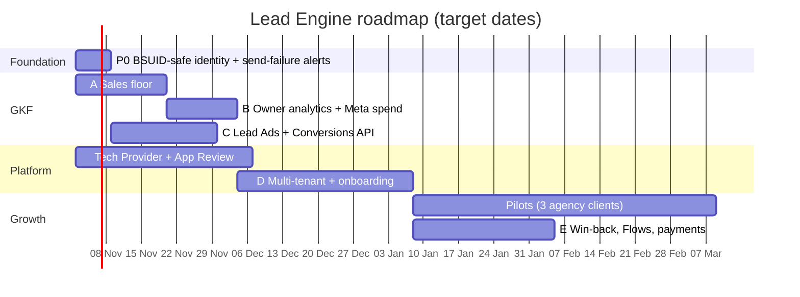

# Product plan

**Lead Engine** (working name): a WhatsApp-first system that connects digital marketing and sales with AI. Ads bring leads; the AI answers in seconds and qualifies them; the sales team is pushed to follow up fast and log what happened; the owner and the agency see which ads produced paying customers; and those outcomes go back to Meta so the ads improve.

Sold **through marketing agencies** to local businesses, starting with gyms in India. Goldkraft Fitness is the live pilot.

- [1. Who it's for](#1-who-its-for)
- [2. Market and where we fit](#2-market-and-where-we-fit)
- [3. The product, feature by feature](#3-the-product-feature-by-feature)
- [4. Roadmap](#4-roadmap)
- [5. Cost plan](#5-cost-plan)
- [6. Pricing (to validate)](#6-pricing-to-validate)
- [7. Go to market](#7-go-to-market)
- [8. Risks](#8-risks)
- [9. Metrics we track](#9-metrics-we-track)

---

## 1. Who it's for

| Who | What they want | What we give them |
| --- | --- | --- |
| **Business owner** (gym, clinic, salon, coaching institute) | More paying customers from the ad money | Instant replies 24×7, a sales team that follows up, a clear "ads → members → ₹" report |
| **Salesperson / front desk** | Know who to call now, with context | Alerts with Call/Open buttons, the full chat, one-tap outcome logging |
| **Marketing agency** | Keep clients by proving ads work | Cost per paying customer per ad, a white-label dashboard, a recurring product to resell |

## 2. Market and where we fit

| Category | Examples | Price (India) | Strong at | Weak at |
| --- | --- | --- | --- | --- |
| Gym management | Yoactiv, FitnessForce, Kondria, MyGymDesk | ₹999–25,000+/mo | Members, billing, attendance, renewals | Ad attribution, AI chat, speed-to-lead |
| WhatsApp API platforms | AiSensy, Interakt, WATI | ₹1,500–4,999/mo + per message | Broadcasts, templates, chatbot builders | Generic; not tied to a sales process or revenue per ad |
| Agency white-label CRMs | GoHighLevel | $97–497/mo | Resell under own brand, funnels | US/SMS-first, expensive in ₹, weak WhatsApp and Indian languages |

**Our gap:** India-first, WhatsApp-native, AI qualification in Hinglish and regional languages, enforced sales follow-up, and revenue per ad, sold through agencies.

**Don't build:** member billing, attendance or class booking (integrate or export instead), or bulk broadcasting.

## 3. The product, feature by feature

### 3.1 AI front desk (exists, keep improving)
- Answers in seconds in the lead's language; free fixed answers for common questions; one AI call per reply (~₹0.03).
- Qualifies in order: goal → experience → timing → visit. Asks a question only when it moves the lead forward.
- Hands off on booking, discount, injury, complaint or "human"; never invents facts.
- Next: WhatsApp Flows for slot booking, per-client FAQ matching instead of keyword lists, a review queue for AI chats.

### 3.2 Sales floor (to build first)
- Hot lead → auto-assigned (round-robin among on-shift staff) → WhatsApp/Telegram ping with Call / Open buttons → **5-minute timer**.
- No contact logged in time → escalate to the manager, then reassign.
- One-tap outcomes: *Called, connected · No answer · WhatsApp sent · Visit booked (date) · Visited · No-show · Joined (plan + ₹) · Lost (reason)*. Each outcome schedules the next follow-up (no answer → 2h, then day 1/3/7).
- **Live board** for everyone (server-sent events, no extra service) and an installable phone app (PWA).
- A staff reply from the CRM counts as contact automatically.

Why: in Velocify's 3.5M-lead study, leads called within a minute converted at almost 4× the rate of leads called at 30 minutes, and only 3-8% of businesses reply that fast.

### 3.3 Owner and agency analytics
- Funnel: lead → contacted → visit booked → visited → joined, with drop-off.
- Speed to lead per salesperson; joins, revenue and lost reasons per person.
- **Per ad / ad set / campaign: leads, joins, ₹ revenue, cost per lead, cost per member, ROAS** (spend from the Marketing API).
- Bot quality: % handled without staff, hand-off reasons, AI cost per lead.
- Nightly digest on WhatsApp/Telegram; a weekly report the agency can forward.

### 3.4 Meta growth loop
- **Lead Ads → WhatsApp in seconds** via the `leadgen` webhook.
- **Conversion Leads + Conversions API for CRM:** send contacted/visited/joined so Meta finds more people who convert.
- **Audiences:** exclude members from ads; lookalikes of people who joined.
- **Win-back:** approved templates for no-shows and quiet leads (Marketing Messages API where allowed), with STOP handling.
- **Catalog and payments:** plan cards in chat; payment link (Razorpay) → "Joined + ₹" logged automatically.

Details and limits: [META_PLATFORM.md](META_PLATFORM.md).

### 3.5 Multi-client platform
- Tenants with `tenant_id` + row-level security; webhook routed by `phone_number_id`.
- **Self-serve onboarding** (target under an hour, see [ONBOARDING.md](ONBOARDING.md)): Embedded Signup v4 (with coexistence), business profile wizard, team invite, ad account connect, test checklist.
- Vertical packs: gym, clinic, salon, coaching institute, real estate (stages, outcomes, FAQs, prompt defaults).
- Agency layer: one login for many clients, white-label logo and domain, cross-client dashboard.
- Billing: Razorpay subscriptions + AI usage.
- Compliance: consent log, opt-out, data export/delete (DPDP from 13 May 2027).

## 4. Roadmap

Each phase ships on GKF first, then pilots. Owners are in [TEAM.md](TEAM.md).

| Phase | Ships | Done when |
| --- | --- | --- |
| **P0 Foundation** | BSUID-safe lead identity; alert on outbound send failures; token-scope runbook | A username-only test user can chat end to end; a broken token pages us within minutes |
| **A Sales floor** | Assign + shifts, 5-min timer + escalation, one-tap outcomes incl. Joined ₹ (**done: R1**), live board, PWA, Telegram alert buttons (**done: K4**) | GKF median time-to-first-contact measured before/after |
| **B Analytics** | Funnel, speed-to-lead, per-person, per-ad revenue, Meta spend import, nightly digest | Owner can answer "which ad made us money this month" in one screen |
| **C Meta loop** | Lead Ads webhook + instant WhatsApp, Conversions API (CRM + business messaging) | GKF runs a Conversion Leads campaign fed by our events |
| **Tech Provider** | Business verification, App Review, privacy policy, data deletion | Meta approves |
| **D Platform** | Tenants + RLS, profile → prompt, Embedded Signup v4 + coexistence, agency dashboard, billing | A new gym goes live in under an hour without code |
| **E Growth** | Win-back templates, Flows booking, payments, AI review queue | Pilot case studies |

## 5. Cost plan

Principle: spend nothing until a paying client needs it, and keep the per-client cost tiny.

| Stage | Hosting | Monthly cost | Notes |
| --- | --- | --- | --- |
| Now (GKF pilot) | Heroku Basic dyno + Postgres Essential-0 | ~$12, covered by student credits | Student credits are for learning/personal projects; move off before charging clients |
| First paying clients (1-20) | One app instance + managed Postgres in an India/Singapore region | ~₹2,000-4,000 | Same code; India region for data and latency |
| 20-100 clients | 2-3 app instances, bigger Postgres, separate worker process | ~₹8,000-15,000 | Still one codebase, one database |

Per client per month (estimate):

| Item | Cost |
| --- | --- |
| AI (3,000 replies, ~41% saved by one-call JSON) | ~₹26 per 1,000 replies → **~₹80** |
| Hosting share at 20+ clients | ₹100-300 |
| Meta messages | Paid by the client to Meta directly |
| Support | The real cost: budget 1-2 hours per client per month at first |

Cost rules in code: fixed answers first, one AI call per reply, cached prompt prefix, per-lead daily cap, monthly AI budget per tenant, and no paid AI calls in tests.

## 6. Pricing (to validate)

| Plan | Price | Includes |
| --- | --- | --- |
| Starter | ₹2,999/mo | AI front desk (3 languages), inbox, 3 users, basic reports |
| Growth | ₹5,999/mo | + sales floor, ad ROI analytics, Meta loop, win-back, 10 users |
| Agency wholesale | ₹1,999-2,999 per client | White-label; agency resells at ₹5,000-10,000 bundled with ads |
| Setup | ₹10,000-25,000 once | Done-for-you profile, FAQs, test pass, team training |

Before fixing prices: interview 10 gym owners and 3 agencies.

## 7. Go to market

1. **GKF case study:** speed-to-lead and cost per member, before vs after.
2. **3 pilot clients** through partner agencies, 60 days, free or half price, in exchange for case studies.
3. **Agency deal:** wholesale price or a 25-30% recurring revenue share.
4. **Expand one vertical at a time:** gyms → clinics/dental → coaching institutes → real estate.

## 8. Risks

| Risk | Level | Response |
| --- | --- | --- |
| Meta policy/pricing changes (AI policy, pricing, BSUID) | High | Keep the bot business-scoped; watch Meta changelogs monthly; keep this repo's [META_PLATFORM.md](META_PLATFORM.md) current |
| Small team: uptime, support, onboarding all on two people | High | Self-serve onboarding, runbooks, alerts before scaling sales |
| Sales staff won't log outcomes → analytics worthless | Medium | Two-tap logging from the alert; measure logging rate per client |
| Data protection (DPDP, 13 May 2027) | Medium | Consent log, export/delete, India hosting in Phase D |
| Scope creep into member management | Medium | Say no; integrate |
| AI mistakes (wrong price, promising a slot) | Low | Facts only from the profile, hand-off rules, review queue |

## 9. Metrics we track

- **Speed to lead:** median minutes from hot lead to first human contact (target < 5).
- **Logging rate:** % of hot leads with an outcome within 24h (target > 90%).
- **Funnel:** lead → visit booked → joined, per source and per ad.
- **Bot:** % answered without staff, AI cost per lead, hand-off rate.
- **Business:** cost per member per ad (needs spend), revenue attributed to ads.
- **Reliability:** failed sends per day (target 0), webhook-to-reply p95 (target < 10s).
