# Lead Engine (Dartit): system map

This map describes the code in this checkout on 17 November 2026.
It uses short sentences and active voice.
The code is the source for current behaviour. TEAM also lists release and setup work.
R15, R16 and R17 were merged on 17 November and run in production (Heroku v41).

## 1. The full loop

A person sends a WhatsApp message or submits a form. The system saves the lead.
The bot answers from the business profile. Staff take over when needed.
Staff log a result. Reports link sales to ads.
Conversions API is built. It is on when a dataset is set, with the required WABA and access token.

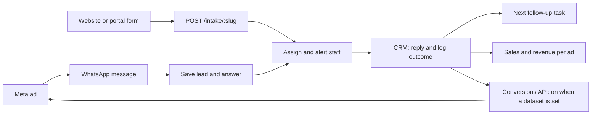

## 2. Infrastructure

One Node.js process serves many client businesses. One Postgres database holds their data.
Production docs name Heroku app `gkf-wa` in the EU, one Basic dyno and Postgres Essential-0.
GKF is tenant 1 and the live pilot. The product supports other business types.

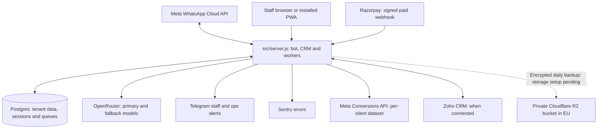

OpenRouter defaults to DeepSeek V4.1 Flash, with Gemini 3.5 Flash Lite as fallback.
Every AI call sets `provider.data_collection: 'deny'` (K29).
Zero data retention is on by default through `provider.zdr: true`.
The app tries the fallback if no provider meets the data policy. It does not relax that policy.

## 3. Host routing and tenants

`src/app.js` checks the host before it mounts bot routes.
In production, HTTP GET and HEAD requests redirect to HTTPS. Other HTTP requests get 403.
Shared CRM hosts take priority over client CRM hosts.

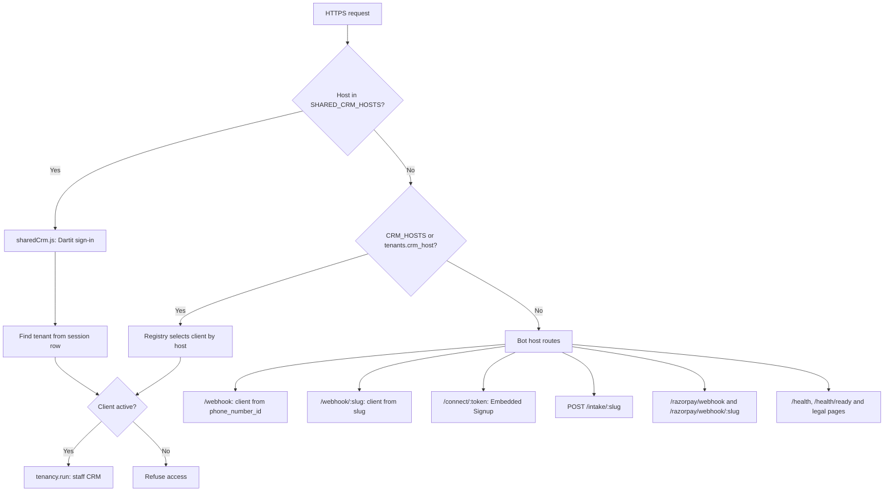

`CRM_HOSTS` selects tenant 1. `tenants.crm_host` selects each other client.
`SHARED_CRM_HOSTS` is empty by default. The shared CRM is built but waits for a domain.
It checks phone or email and password in active clients. Several matches show a business choice.
Choice tickets last five minutes and work once in the same browser.
The session supplies the tenant for later requests. The shared host uses Dartit branding.
Client hosts keep their own brand. Do not use a bot host as a shared CRM host.

K8 is built. `src/tenancy/registry.js` loads clients, settings and encrypted secrets.
Tenant 1 can fall back to environment settings. Other tenants do not use that fallback.
`tenancy.run(id, fn)` sets the client for a request or job.
The database sets the client on each connection and enforces forced row-level security.
Queries with no tenant or system context fail closed.
`tenancy.runAsSystem(fn)` permits platform work across clients.
Client tables have `tenant_id`. Lead keys and foreign keys include the tenant.
Secrets use AES-GCM and `TENANT_SECRETS_KEY`. Tenant and profile caches refresh every 60 seconds.

K9 is built in `src/routes/connect.js` and `src/services/embeddedSignup.js`.
A signed connect link opens Embedded Signup on the bot host.
The service exchanges the code, checks number ownership and saves the encrypted token.
It subscribes the app and registers a Cloud API number.
For coexistence, it starts contact and history sync. `tenant -- whatsapp-finish` retries setup steps.
Coexistence echoes and history in the CRM are still pending.

## 4. Inbound message: from WhatsApp to stored work

The webhook checks the signature and selects the client. It saves each event before it returns 200.
Unknown or suspended clients cannot use the normal message path.
The inbound worker has three slots. Each job runs as its stored tenant.

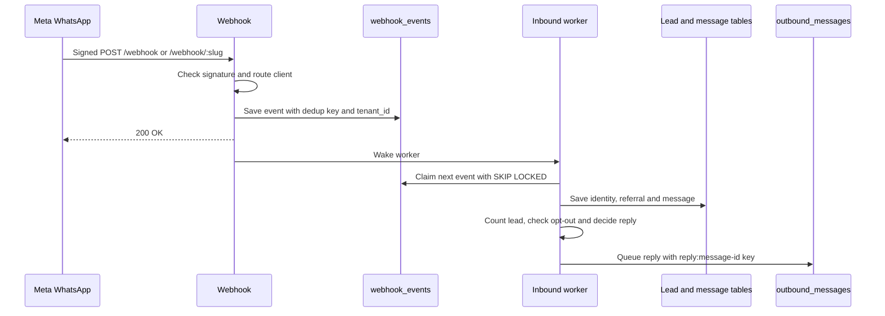

Claims preserve order for each client and lead. Different leads can run in parallel.
Text events wait for `BURST_SETTLE_MS` (default two seconds).
In-process signals wake workers on new work. Polling every `QUEUE_POLL_MS` (default ten seconds) catches retries.
Queues retry failed work and retain final failures for inspection.

## 5. Reply decision, opt-out and health mode

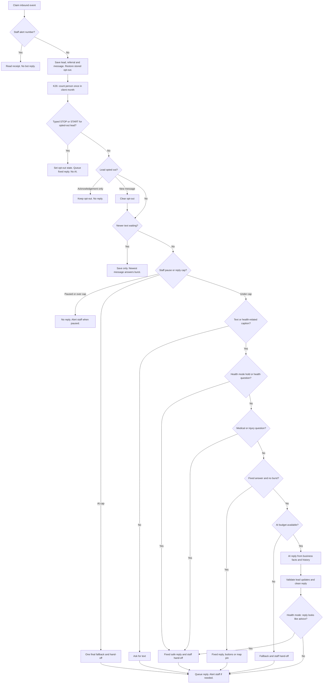

STOP and UNSUBSCRIBE use a fixed reply (K30). Button titles never count as opt-out instructions.
START or a real new message clears opt-out. A short acknowledgement keeps it.
`opt_out_list` keeps a keyed hash when an opted-out lead is deleted (K31).
The next inbound message restores that state before the worker checks opt-out.
Templates to opted-out leads are refused. Staff alert templates are exempt.

K26 records WhatsApp and intake contacts once per person per client calendar month.
`lead_usage` stores a keyed identity hash. It survives lead deletion.
With a limit, Telegram alerts fire at 80% and 100%, once per month and level.
The limit does not stop replies. Dashboard, Business settings and the usage script show counts.
A hidden identity that later gains a phone can count twice in the same month.

The staff pause defaults to 12 hours. The per-lead cap defaults to 30 bot replies per 24 hours.
Staff can turn AI back on from the lead page. A later staff reply pauses it again.
Fixed answers cover greetings, hours, location, prices, trial, human requests, complaints, negotiation and data deletion.
A burst skips fixed answers so the AI can answer all unanswered messages together.

K33 uses `profile.healthRelated`. Health questions get a fixed response and a hand-off before any AI call.
The check includes unanswered text and media captions. An open health hand-off keeps the bot out.
A final check replaces AI text that looks like advice. Alerts use a generic summary.
The AI can suggest lead fields and outcomes. Policy limits field changes.
Staff must confirm suggested outcomes. AI never records a sale by itself.

## 6. Outbound sends, errors and reply times

The outbound worker has two slots. It preserves order for each client and recipient.
It sends CRM replies, bot replies, welcome templates and staff alerts through the same queue.

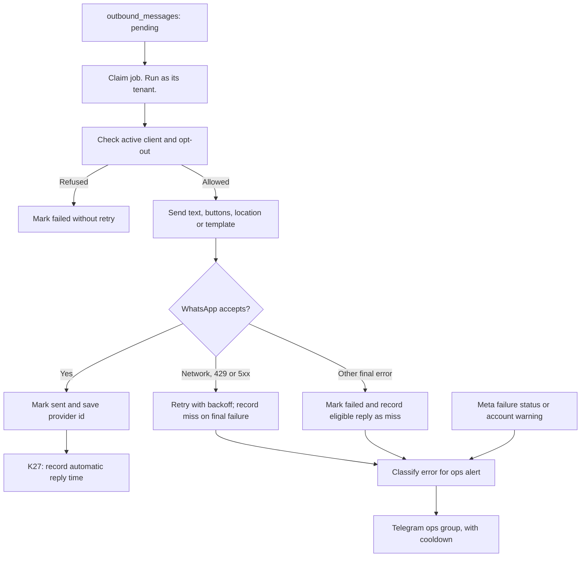

A queued reply is dropped if the lead opted out after it was queued.
Template sends check both the lead and the stored opt-out list.
Ops alerts group account, payment, permission and rate errors. The default cooldown is 30 minutes.

K27 measures each automatic reply from receipt of the last message in its burst to WhatsApp acceptance.
It uses the inbound row's `created_at`, not the sender's clock. It does not measure delivery.
CRM replies, templates and staff alerts do not count.
Final send failures count as misses. p95 uses sent replies.
The target is 95% within 30 seconds. Owners see monthly figures in Reports.
The service-level script reports all clients. Housekeeping keeps rows for 400 days, about 13 months.
A crash between send and metric storage can leave one reply uncounted.
External uptime monitoring still needs an account and setup.

## 7. Lead identity and lead intake

Lead keys are `(tenant_id, wa_id)`. The same person can contact two clients without sharing a lead row.
Meta can hide a phone behind a business-scoped user ID (BSUID).
The system keeps phone, user ID and username when Meta shares them.
Identity changes move the lead to its new key. Sends use the phone when known, else the BSUID.

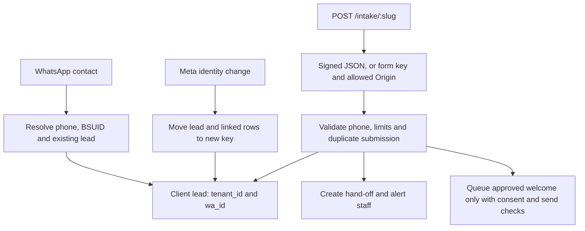

R16 accepts portal JSON with `X-Intake-Signature` (HMAC-SHA256 of the raw body).
Website forms need an allowed Origin and public form key. A honeypot catches simple bots.
The service hashes IPs for rate limits. It stores submissions for duplicate checks and limits.
A form does not clear a WhatsApp opt-out.
Welcome templates need consent, a configured template and available limits. An open chat does not need a welcome.
Portal-specific adapters are still pending.

## 8. CRM roles and screens

K25 supports phone or email sign-in with a password. It does not use phone OTP.
Sessions, CSRF checks, login throttles and first-login password changes protect the CRM.

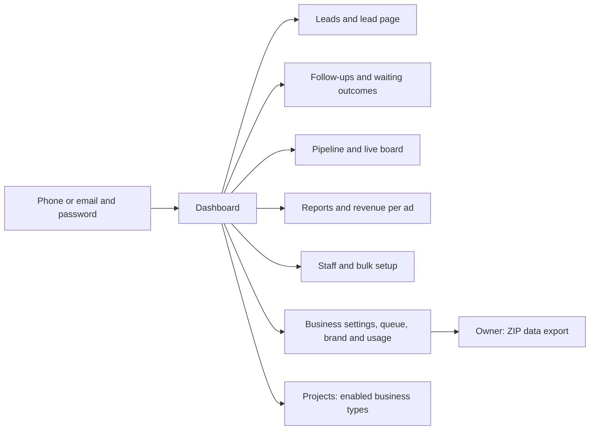

| Role | Lead scope | Reports | Staff | Business settings |
| --- | --- | --- | --- | --- |
| Owner | All client leads | Yes | All client staff | Yes |
| Manager | Own team | Yes | Own team | No |
| Sales | Own leads | No | No | No |

R3 provides live updates through server-sent events and database notifications.
R4 provides an installable phone app (PWA).
R6 shows leads, qualified leads, customers, revenue and a quality grade per ad, plus CSV.
Spend, cost per sale, ROAS and campaign roll-ups wait for K5 spend data.
R19 gives owners a ZIP with a README and CSVs for leads, chats, outcomes, notes, assignments, hand-offs, follow-ups, payment links and staff.
Exports use the client's tenant context. They exclude passwords, sessions and tokens.

## 9. Staff hand-offs, lead queue and outcomes

K19/R2 is built. The owner turns automatic assignment on in Business settings.
A new hand-off gets a salesperson in turn before alerts go out.
Existing staff assignments remain useful for follow-up and lead access.
The queue measures working minutes in the client's time zone and working hours.
After five minutes without pickup, it alerts the manager, or owners if no manager is active.
After 15 minutes, it alerts owners.
Alerts go to Telegram and eligible staff WhatsApp numbers.

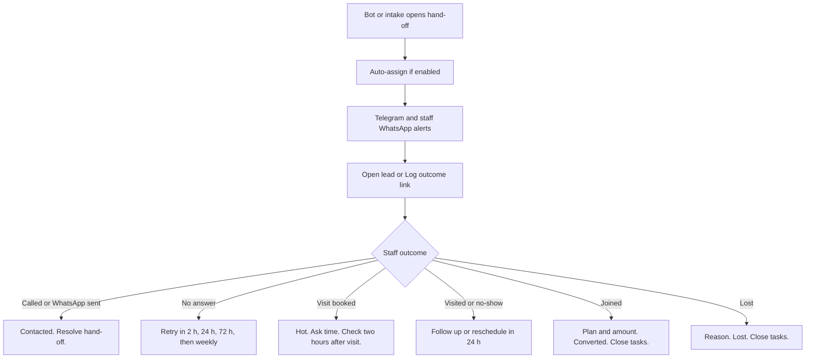

WhatsApp sent creates a check in 24 hours. Each outcome closes the previous automatic follow-up.
A converted lead does not move back to hot from a later outcome.
Telegram's Log outcome link opens `#outcome` on the lead page.
Staff WhatsApp alerts use the approved `staff_lead_alert` template.
AI-suggested outcomes need staff confirmation on the lead page (K13).
Razorpay payment links are optional (K11). A signed paid webhook logs Joined once and alerts staff.
Zoho sync is optional per client (K20). It pushes lead changes and outcomes, and reads Zoho changes every five minutes.
It can record Joined or Lost through the CRM rules. It does not undo a won sale.

## 10. Pipeline, projects and currency

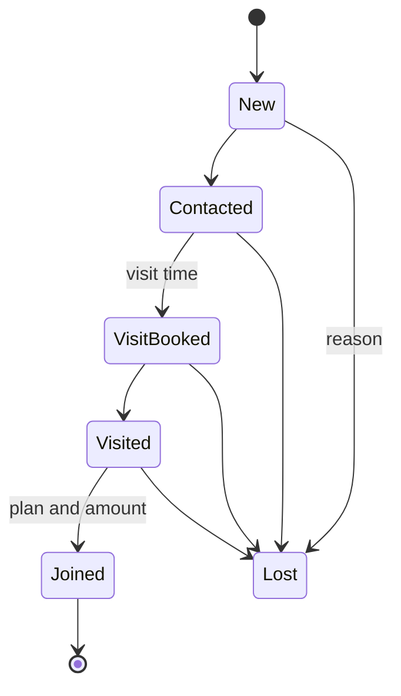

The CRM derives stages from lead status and visit outcomes. Business presets change display names.
Desktop staff drag cards. Phone users move cards through the mobile controls.
Sales staff can move only their leads.

R15 supports INR, AED, SAR and USD through `profile.currency` and `src/config/currency.js`.
Amounts use whole currency units. The column name `amount_inr` is historical.
CRM displays, bot alerts and Purchase events use the business currency.
Changing currency does not convert stored amounts. Payment links remain INR-only.
Zoho transfers numeric amounts without currency conversion.

R17 stores projects and units for business types that enable the page, currently real estate.
Owners and managers can edit, archive, reorder and mark units sold out.
Staff can send selected units as one plain WhatsApp reply within the reply window.
The selection allows at most 30 units and ten projects.
Catalog IDs and sync fields exist, but catalog sync and product-list messages are not built.
The bot still reads its facts from Business settings, not the Projects page.

## 11. Conversions API (K7)

Conversions API is built and is **on when a dataset is set**.
The client also needs a WABA, access token and required Meta permission.
TEAM still lists production activation and Events Manager checks as K7b.
The docs do not confirm that GKF sends live events. This map does not claim that it does.

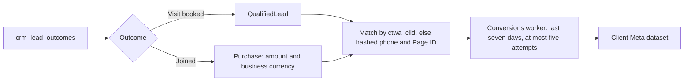

Send state lives on each outcome. The worker records sent, skipped, failed or dead state.
It skips events that lack a valid match or client setup.
It sends no chat text or health detail. Early chat-score events and Lead Ads stages are not built.

## 12. Business profile and AI facts

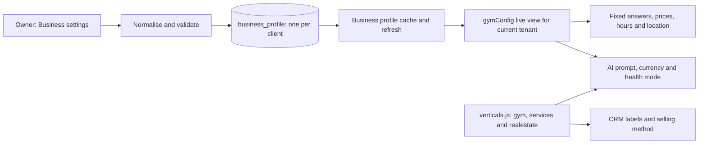

Owners can change facts without a deploy. Presets hold generic selling rules and labels.
The AI uses a short message history and per-client monthly budgets.
The service cleans generated text and applies policy to suggested updates.

## 13. Data model and migrations

Bot migrations live in `src/db/schema.js`. CRM migrations live in `crm/src/migrations.js`.
Those lists are frozen. New migrations go in `src/db/platformMigrations.js`.
Migration trackers are `schema_migrations`, `crm_migrations` and `platform_migrations`.

| Platform ID | Name | Main change |
| --- | --- | --- |
| 1 | `tenancy` | `tenants`, tenant keys, composite lead links and forced row-level security |
| 2 | `zoho_sync` | `zoho_links`, `zoho_cursors` and change triggers |
| 3 | `lead_queue` | `crm_settings` and queue assignment state |
| 4 | `live_board` | Database notifications for CRM updates |
| 5 | `login_phone` | Staff phone sign-in |
| 6 | `opt_out` | `leads.opted_out_at` |
| 7 | `lead_intake` | Intake source data and `intake_submissions` |
| 8 | `projects` | `crm_projects`, `crm_units` and catalog fields |
| 9 | `lead_usage` | Hashed monthly counts and threshold alert claims |
| 10 | `reply_times` | Automatic reply measurements and final misses |
| 11 | `opt_out_list` | Hashed opt-outs that survive lead deletion |

The current migration array places ID 8 after ID 11. The runner uses array order and tracks applied IDs.

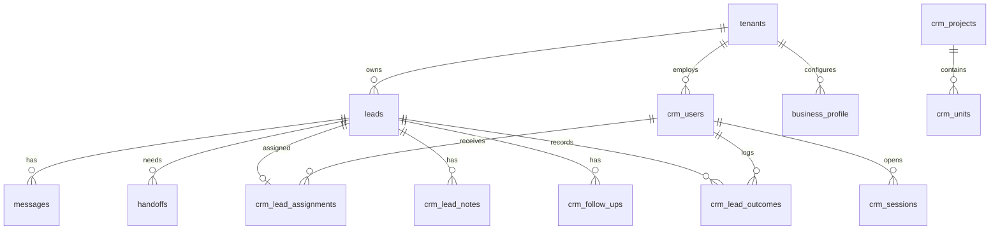

These links describe the main ownership model. Queue recipient keys are not all foreign keys.

| Main tables | Purpose |
| --- | --- |
| `tenants` | Client registry, hosts, number IDs, settings and encrypted secrets |
| `leads`, `messages`, `handoffs` | Identity, conversation, opt-out state and human requests |
| `webhook_events`, `outbound_messages` | Durable inbound and outbound queues with dedup and retry state |
| `business_profile`, `ai_usage` | Business facts and AI usage, cost and budget data |
| `crm_users`, `crm_sessions` | Staff, roles, teams, phone sign-in and sessions |
| `crm_lead_assignments`, `crm_lead_notes`, `crm_follow_ups` | Lead ownership, notes and tasks |
| `crm_lead_outcomes`, `crm_payment_links` | Results, revenue, Meta send state and payment links |
| `crm_activity_log`, `crm_settings`, `crm_branding` | Audit events, daily job claims, queue settings and brand |
| `zoho_links`, `zoho_cursors` | External record links, sync state and read cursors |
| `intake_submissions` | Intake dedup, rate limits and acceptance results |
| `crm_projects`, `crm_units` | Projects, inventory and future catalog sync state |
| `lead_usage`, `lead_usage_alerts` | Monthly keyed identity hashes and alert claims |
| `reply_times` | Receipt and dispatch times, elapsed time and outcome; no lead key |
| `opt_out_list` | Keyed identity hashes for persistent opt-out |

Client data tables use tenant policies. Platform migration trackers and the tenant registry serve system work.

## 14. Build and deploy

```mermaid
flowchart LR
  BR["Feature branch"] --> PR["Pull request and review"]
  PR --> CI["GitHub Actions: bot and CRM tests on PGlite"]
  CI --> MERGE["Merge after checks and review"]
  MERGE --> DEPLOY["Kaamil authorises and deploys to Heroku"]
  DEPLOY --> BUILD["Install dependencies and build CRM CSS"]
  BUILD --> RELEASE["Procfile release: scripts/migrate.js"]
  RELEASE --> BOOT["Procfile web: src/server.js"]
```

Migrations run bot, CRM and platform changes under advisory locks.
The server also runs migrations on boot. Applied IDs prevent repeat changes.
This diagram describes the workflow. Updating this map does not run it.

## 15. Process start, background jobs and housekeeping

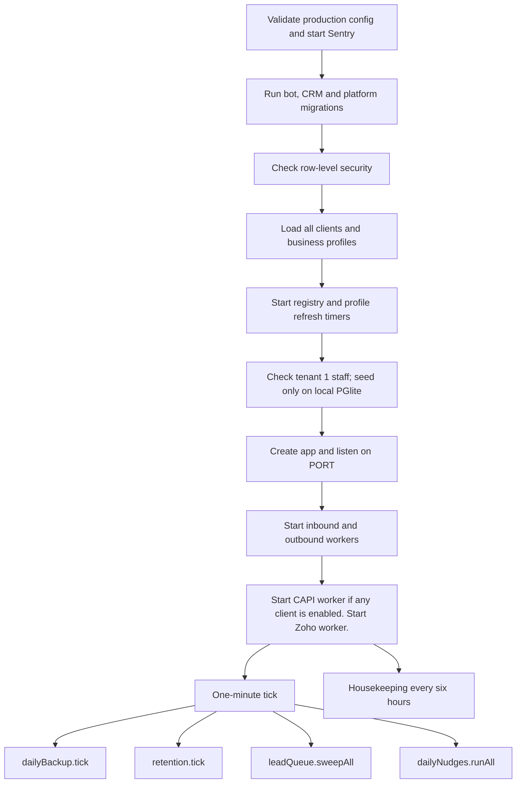

Each tick starts the four jobs separately. Each job decides whether work is due.

| Job | Schedule and action |
| --- | --- |
| K28 backup | Once daily after `BACKUP_HOUR_UTC`, default 21:30 UTC. Export client data as gzipped JSON, encrypt with AES-256-GCM, upload to private R2 and read back to verify. Retry failures after 30 minutes. Alert ops on success, failure or missing setup. |
| K31 retention | Once daily per active client after `RETENTION_HOUR_UTC`, default 22:00 UTC. Delete inactive leads after `retentionMonths`, default 24 months. Use the shared lead deletion service. |
| K19/R2 queue sweep | Check active clients each minute. Escalate leads not picked up after five and 15 working minutes when auto-assign is on. |
| R11 morning reminders | Once per client local day, inside working hours from the start of its working day. Send waiting-outcome lists to Telegram and eligible staff WhatsApp numbers. Send unassigned lists to owners and managers. |

K28 code is built. Backup storage is not configured yet, and the restore drill is not done.
Forced row-level security prevents the normal Heroku `pg_dump` backup path.
The app backup excludes login sessions. Storage lifecycle setup must remove files after 30 days.
Keep both backup and tenant encryption keys outside Heroku for recovery.

Retention checks all lead activity, including queued work and future follow-ups.
It checks each lead again under a row lock before deletion.
It deletes at most 200 leads per client per night.
It stops if more than 20% of a client's leads, and over 50 leads, are due together.
A dated client setting can allow that surge. `LEAD_RETENTION=off` stops automatic deletion.
Deletion keeps hashed usage, reply metrics and hashed opt-outs.
Manual data deletion uses the same service. A bot data deletion request opens a staff hand-off.

Daily reminders use `crm/src/nudges.js` and `src/services/dailyNudges.js`.
They find open leads waiting two hours to 30 days for an outcome after a hand-off or hot lead contact.
Database claims and advisory locks prevent repeat daily jobs.

Housekeeping runs as system work every six hours:

- Remove completed and failed webhook events older than 14 days.
- Remove sent outbound queue rows older than 30 days.
- Remove intake submissions older than 90 days.
- Remove reply measurements older than 400 days.

`/health` checks the process. `/health/ready` checks the database and returns 503 during shutdown.
The CRM has its own health route for CRM tables.
On SIGTERM or SIGINT, the server stops accepting requests and stops queue workers before it closes the database.
It gives in-flight work up to 25 seconds to finish.

## 16. What is not built yet

TEAM lists these remaining product features:

- K5 ad spend import, K21 report analyser and R18 client value page.
- K12 lead scoring and early qualified events; K6 Lead Ads capture and stages.
- K24 Meta catalog sync and product messages; K32 Instagram DM capture.
- K22 general CRM connectors beyond the built Zoho connector.
- R9 agency dashboard and R10 subscription billing UI.
- Coexistence echoes and history in the CRM; later benchmarks and win-back tools.

Fair queue claims across tenants are also pending. Current queues preserve lead order but use FIFO across clients.
Setup work remains for backup storage and a restore drill, the shared CRM domain, external uptime monitoring and K7b live event checks.
