# GKF Lead Engine: system map

This file shows how the system works, from the ad to the server.
The text uses ASD-STE100 Simplified Technical English: short sentences, active voice, one idea in each sentence.

## 1. The full loop

A person sees an ad. The person sends a WhatsApp message. The bot replies. Staff follow up. Staff log the result. The system can send the result back to Meta.

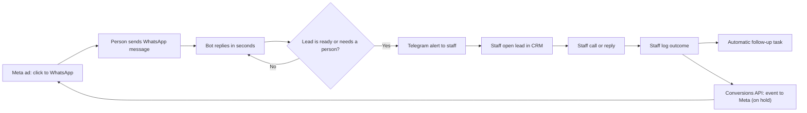

## 2. Infrastructure

One Heroku app runs everything. One Postgres database keeps all data.

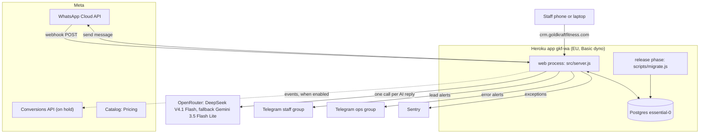

| Part | Job | Cost |
| --- | --- | --- |
| Heroku dyno | Runs bot, CRM and workers in one process | Student credit |
| Heroku Postgres | Keeps leads, messages, queues, CRM data | Student credit |
| OpenRouter | AI replies | About $0.31 for 1,000 replies |
| Meta WhatsApp | Sends and receives messages | Service replies free in 24 h window |
| Telegram, Sentry | Alerts | Free |

## 3. Host routing

One Express app reads the host name. The host name selects the bot or the CRM.

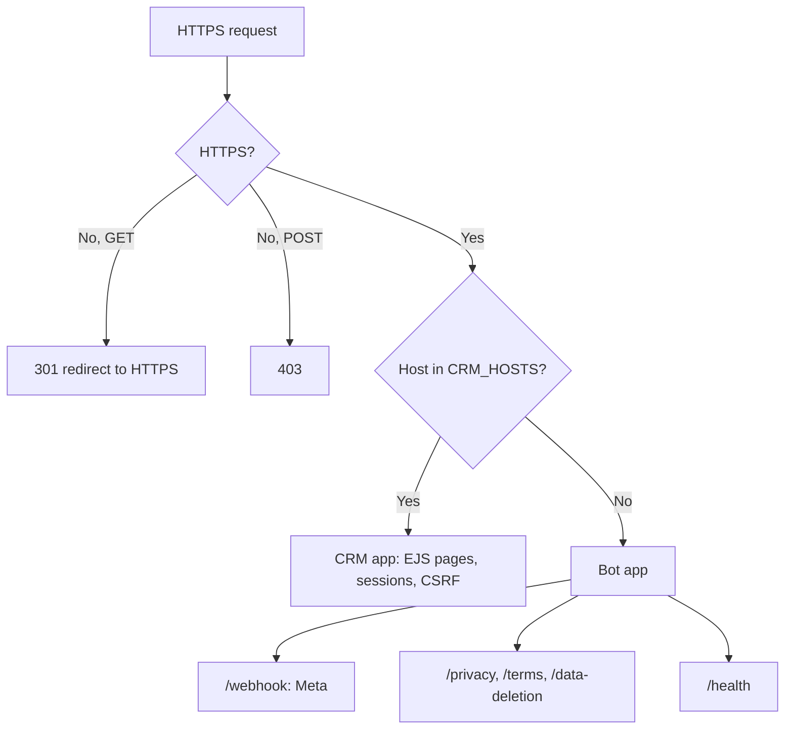

## 4. Inbound message: from WhatsApp to reply

The webhook saves the event first. A worker does the slow work later. Thus Meta always gets a fast 200.

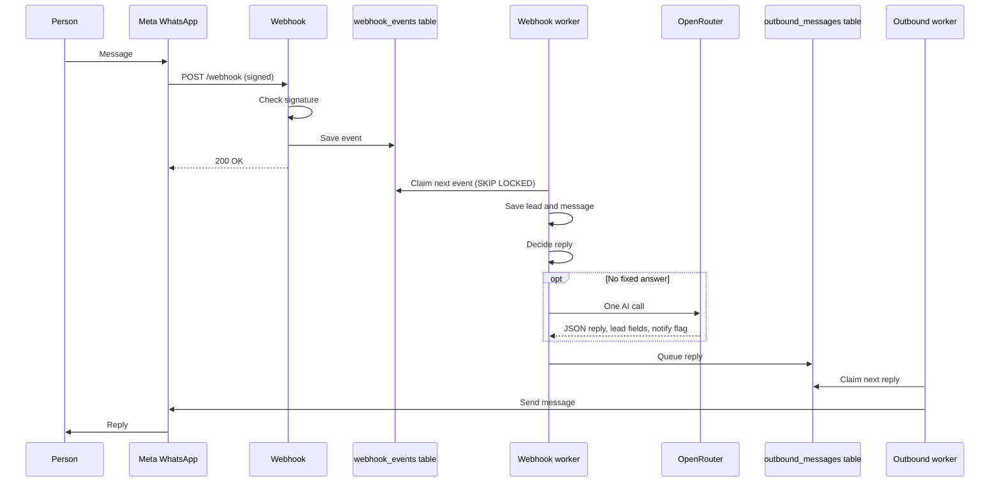

## 5. Reply decision

The worker tries the cheap paths first. The AI is the last step.

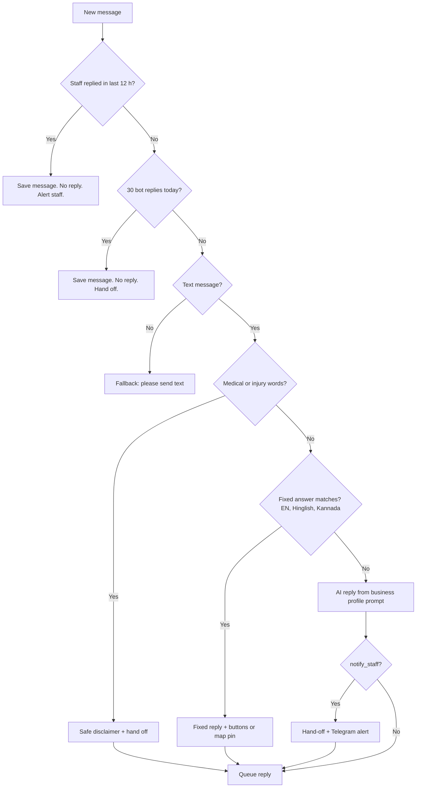

Fixed answers: greeting, hours, location, prices, trial, human, complaint, negotiation, data deletion.

## 6. Outbound send and errors

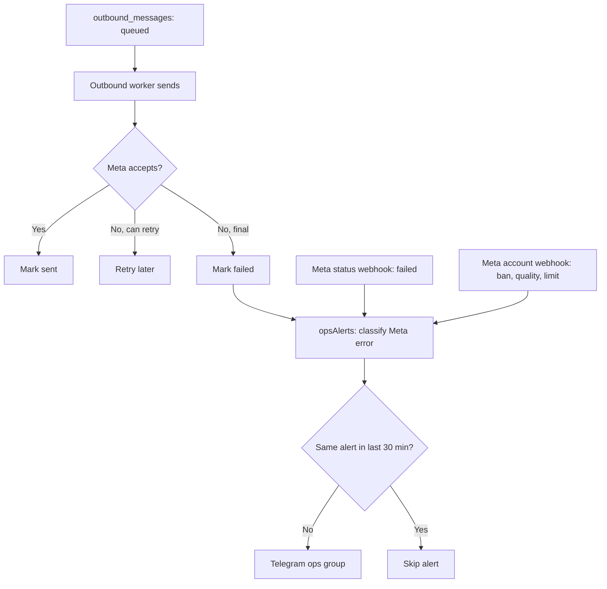

## 7. Lead identity

Meta now can hide phone numbers behind usernames (BSUID). The system keeps one key for each person.

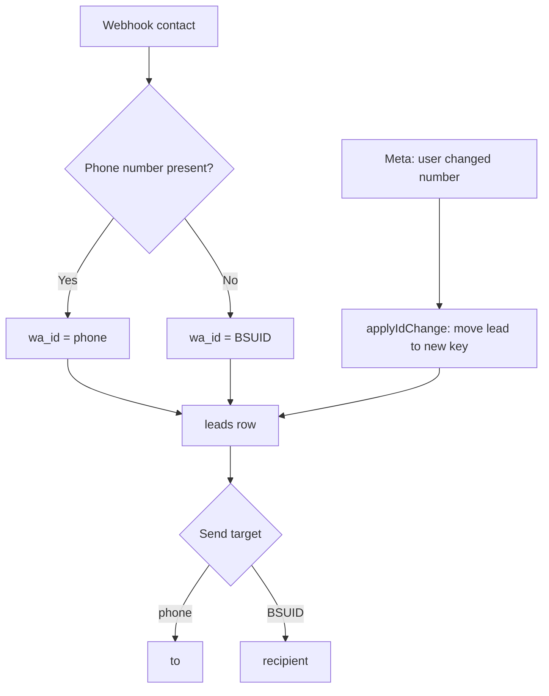

## 8. CRM roles and screens

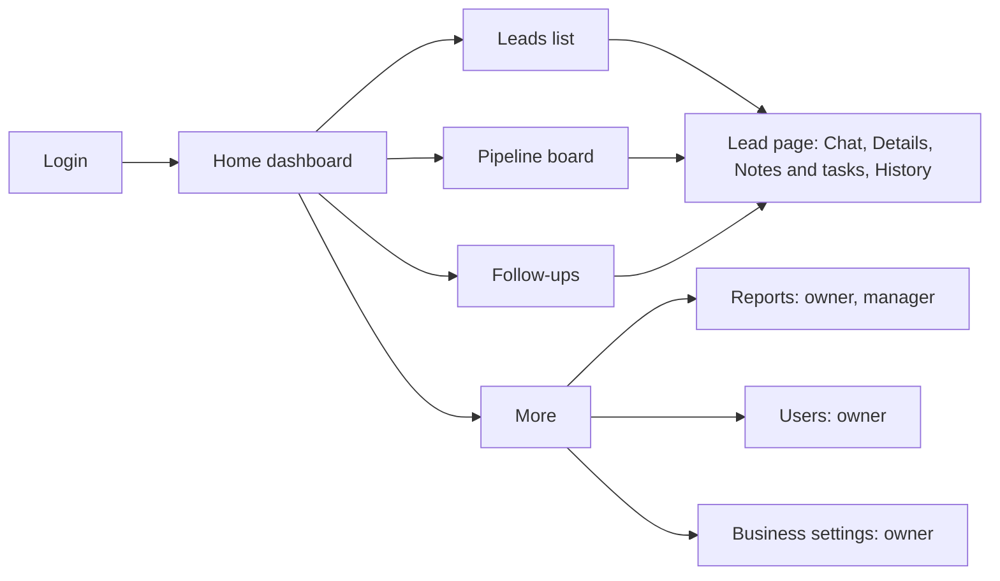

| Role | Sees leads | Reports | Users | Business settings |
| --- | --- | --- | --- | --- |
| Owner | All | Yes | Yes | Yes |
| Manager | Own team | Yes | Own team | No |
| Sales | Own leads | No | No | No |

## 9. Lead page and outcomes

Staff log one outcome. The system makes the next task.

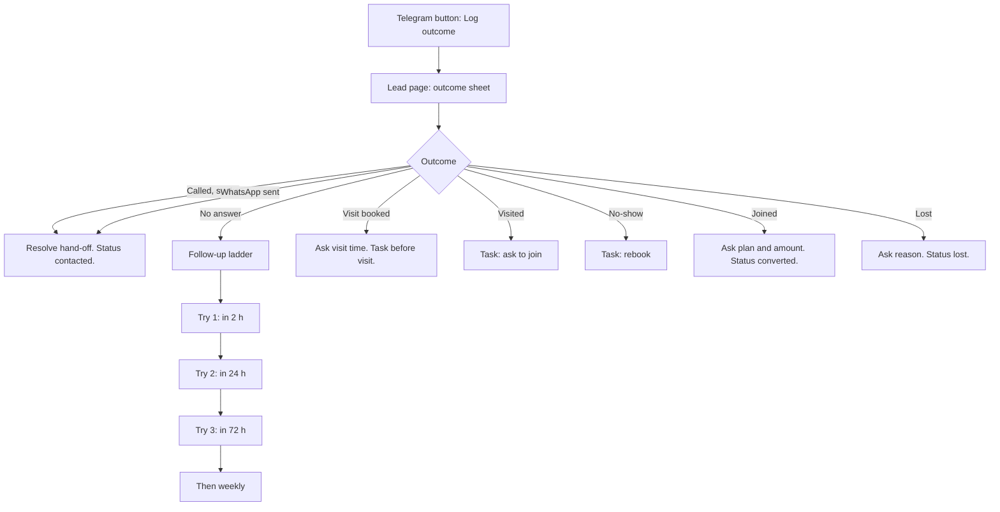

## 10. Pipeline board

The columns show the sales journey. The stage comes from status and the latest visit outcome.

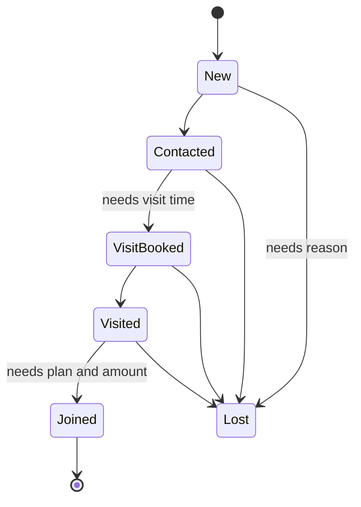

Desktop: drag the card. Phone: swipe columns and tap Move. Sales can move only their own leads.

## 11. Conversions API (on hold)

This part is off. It starts after the GKF Instagram page connects.

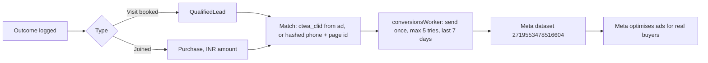

## 12. Business profile

The owner edits the business facts in the CRM. The bot reads them. No deploy is necessary.

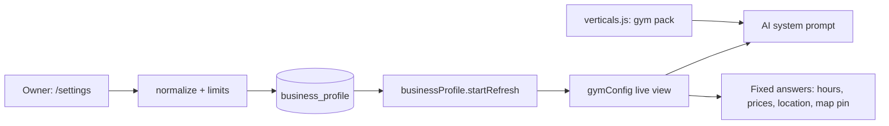

## 13. Data model

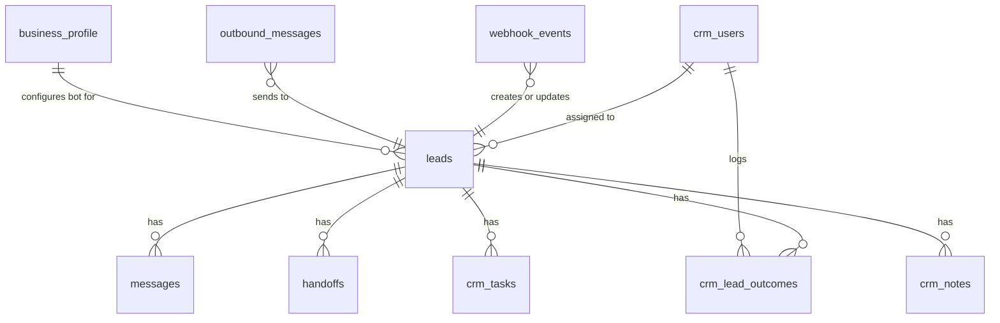

## 14. Build and deploy

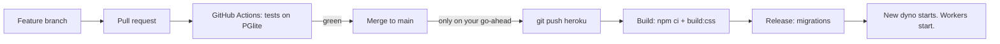

## 15. Process start

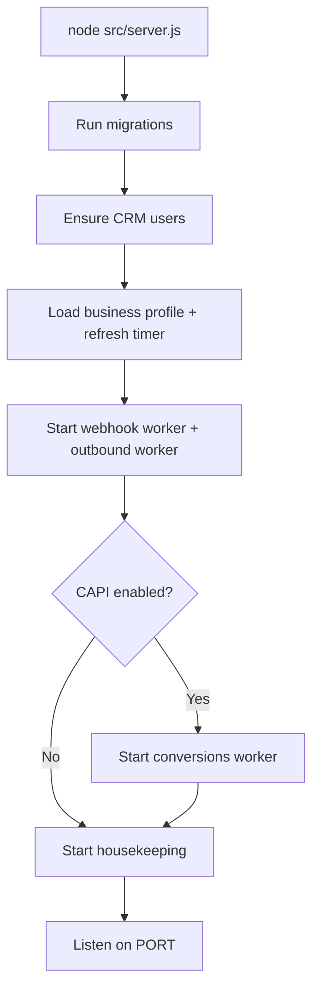

## 16. Next: K8 multi-client

Today one database serves one business. K8 adds a business id to each table. One app then serves many gyms through agencies.

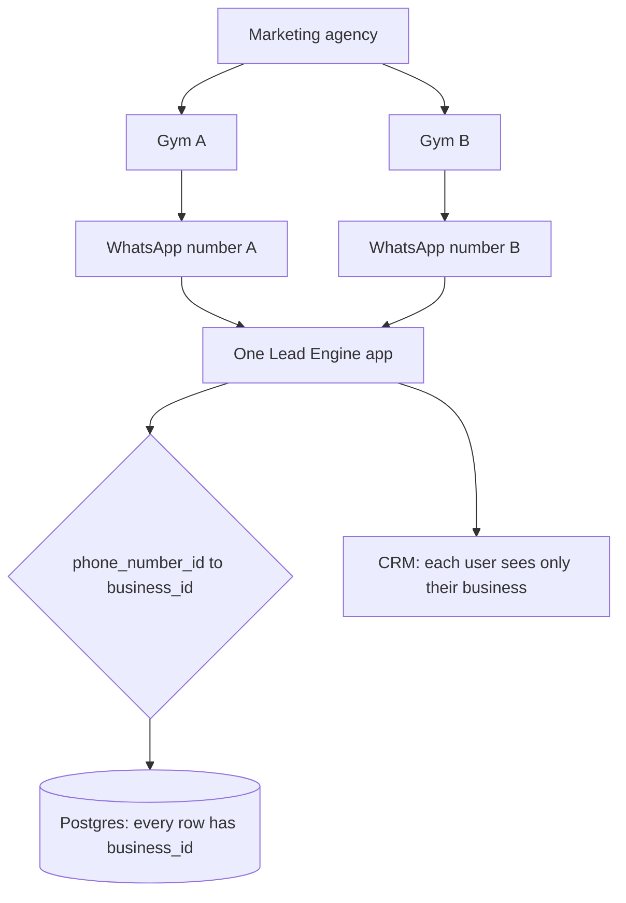
